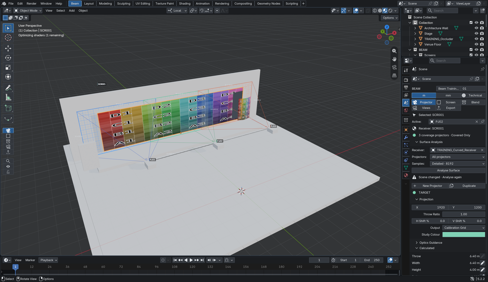
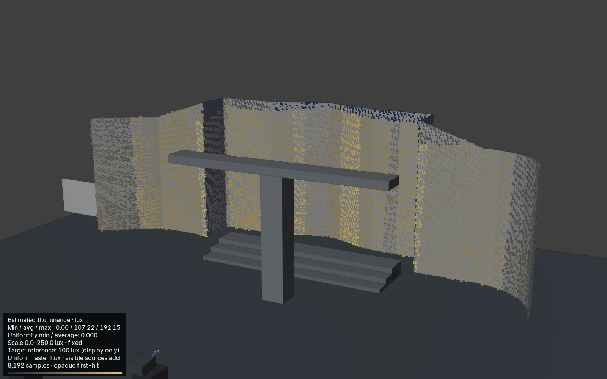

# Beam

Beam is a professional projection-planning and study tool built inside Blender. Blender provides the 3D authoring environment; Beam adds projection-specific planning, engineering and review tools to place projectors, check coverage and obstructions, plan blends, and export a study for handoff.

**Maintainer:** Twisted Pixel

**Current:** Beam 0.13.0 — Internal Production Beta

**Tested:** Blender 5.2.2 LTS · macOS 26.7 · Apple silicon / Metal

> Still in testing, not stable production software. Work on copies and independently verify geometry, measurements and exported data before production use. Windows/Linux are not yet validated.

**[Download 0.13.0](https://github.com/twistedpixelpete/beam/releases/tag/v0.13.0-beta)** · **[Start Here](#start-here)** · [Enable Beam Workspace](#beam-workspace) · [User Guide](output/pdf/Beam_Onboarding/Beam_User_Guide.pdf) · [Quick Start](output/pdf/Beam_Onboarding/Beam_Quick_Start.pdf)

## Download

The [0.13.0 release](https://github.com/twistedpixelpete/beam/releases/tag/v0.13.0-beta) contains:

- **[beam-0.13.0.zip](https://github.com/twistedpixelpete/beam/releases/download/v0.13.0-beta/beam-0.13.0.zip)** — installable Blender extension. Keep this ZIP zipped.
- **[Beam-Onboarding-0.13.0-beta.zip](https://github.com/twistedpixelpete/beam/releases/download/v0.13.0-beta/Beam-Onboarding-0.13.0-beta.zip)** — clean onboarding package, including the same installer.

0.13.0 is the first GitHub release after 0.8.1 and consolidates the internal 0.9–0.12 development milestones. Those milestones were not separate published GitHub releases.

## Install

1. Download `beam-0.13.0.zip` and open Blender.
2. Open **Edit → Preferences → Get Extensions**.
3. Open the menu at the top right and choose **Install from Disk**.
4. Select `beam-0.13.0.zip` and enable Beam if prompted.
5. Restart Blender after replacing an older build. Keep only one Beam installation enabled.
6. With the pointer over the 3D View, press **F3**, search for **Open Beam Workspace**, and run it. If your keyboard configuration uses F3 differently, use **Edit → Menu Search**. Alternatively, press **N**, open the **Beam** tab, expand **Project / Workspace**, and click **Open Beam Workspace**.

The manifest requires Blender **4.5+**; validation is on the tested environment above. No separate Python installation is needed to use Beam. Install the extension ZIP, not GitHub's source-code archive.

## Beam Workspace

The optional **Beam** workspace brings projection planning into one Blender layout: a native 3D View, the Outliner for scene selection, and a Beam inspector in **Properties → Scene**. Its five modules are **Projector**, **Screen**, **Blend**, **Views** and **Export**. Use the left viewport toolbar or the inspector's module buttons to move between them. Blender's normal modelling, navigation and editor controls remain available.

### Enable and open the workspace

1. Install and enable the Beam extension first, then restart Blender after an upgrade.
2. Select Blender's **Layout** workspace. It must contain a **3D View**, **Outliner** and **Properties** editor.
3. In the 3D View, choose **View → Open Beam Workspace**. Alternatively, press **F3** and search for **Open Beam Workspace**, or use **Edit → Menu Search**.
4. Beam creates a **Beam** workspace tab from your current layout. Click that tab to return to it later; running **Open Beam Workspace** again opens the existing Beam workspace.

You can also open it from the regular sidebar: place the pointer over the 3D View, press **N**, choose **Beam**, expand **Project / Workspace**, and click **Open Beam Workspace**.

The original Layout workspace and scene are retained. Resize the editor borders to suit your screen. If the Beam inspector disappears after choosing another Properties tab, select **Scene Properties**, or run **Open Beam Workspace** again. If the left toolbar is hidden, press **T** over the 3D View or use the inspector's module buttons. If Beam reports missing editors, return to a Layout containing all three editors listed above and retry.

**The workspace and colour theme are separate.** Under **Project / Workspace**, **Apply Beam Theme** optionally changes Blender's application-wide theme; **Restore Previous Theme** restores the saved backup. Opening the workspace does not apply the theme. You can also use Beam through **N → Beam** without creating its workspace.

## Start Here

Extract **[Beam-Onboarding-0.13.0-beta.zip](https://github.com/twistedpixelpete/beam/releases/download/v0.13.0-beta/Beam-Onboarding-0.13.0-beta.zip)** and open `Beam_Onboarding/START_HERE.pdf`. The package contains exactly six files:

| File | Purpose |
| --- | --- |
| [START_HERE.pdf](output/pdf/Beam_Onboarding/START_HERE.pdf) | Installation and learning order. |
| [Beam_Quick_Start.pdf](output/pdf/Beam_Onboarding/Beam_Quick_Start.pdf) | First screen, projector and layout. |
| [Beam_User_Guide.pdf](output/pdf/Beam_Onboarding/Beam_User_Guide.pdf) | Full workflow and control reference. |
| [Beam_Training_Project.blend](output/pdf/Beam_Onboarding/Beam_Training_Project.blend) | Self-contained starting scene; use Save As to make a working copy. |
| [Beam_Training_Project_Guide.pdf](output/pdf/Beam_Onboarding/Beam_Training_Project_Guide.pdf) | 21 guided exercises. |
| [Install/beam-0.13.0.zip](output/pdf/Beam_Onboarding/Install/beam-0.13.0.zip) | Validated extension installer. |

The training project demonstrates projectors, a screen, a Blend Group, Auto Blend / Reflow, Reverse Mapping, all five Surface Intelligence modes, an Observer, Study Views and exports. Screenshots are embedded in the guides; no separate image downloads are required.

## Main features

### Projector Planning

Create and duplicate projector objects, target venue geometry, and preview real-time frustums and projected output. Set throw ratio, lens shift, raster, lumens and brightness; inspect calculated image size, density and pixel size. Ordinary visible venue meshes can receive projection; a Beam screen is optional.

### Screens

Build managed Flat, Arc, Curve, Closed or Surface screens with dimensions, aspect, calibration patterns and labels. LED workflows add cabinet-based dimensions and raster. Use **Update Screen** after parameter changes; export evaluated display geometry as OBJ or FBX. See the [Screen Builder reference](docs/SCREEN-BUILDER.md).

### Blend Groups

Group existing projectors or use **New Auto Blend** for a screen layout. Set overlap, compare requested versus actual overlap, duplicate groups and edit members. **Reflow** recalculates spacing after optics or distance changes and clears member position tweaks. Overlap and feather previews use a nominal reference plane; inspect actual receiver coverage separately.

### Inverse Solver

Solve from image width, height or throw by adjusting lens or position, subject to locks and optics constraints. Transactional validation refuses unsupported results without leaving a partial change. See the [planning workflow reference](docs/PLANNING-MILESTONE.md).

### Optics Guidance

Use **Generic / Manual** settings or sourced projector/lens presets with validated nominal throw ranges. Unknown shift envelopes and unsupported constraints remain explicit; a preset is not evidence that every shifted or coupled lens configuration is supported. See [optics sources and validation](docs/PRODUCTION-VALIDATION.md).

### Study Views

Save review cameras, switch between **Technical / Presentation** workflows, choose annotations and analysis overlays, then export individual views or a batch. Study Views recall cameras, not receiver selection. Run **Analyse Surface** again after scene changes or reopening before exporting analysis.

### Reverse Mapping

Preview coverage while preserving the source material and its UV mapping. Choose **Covered Only**, **Uncovered Dimmed**, **Uncovered Hidden** or **Overlap Diagnostic**. Use Material Preview or Rendered viewport for material-based coverage review.



*Current 0.13 training workspace: source UV content is revealed within projector coverage.*

### Surface Intelligence

Under **Surface Analysis**, choose the receiver, projector scope and sample count, then click **Analyse Surface**. Five modes provide sampled planning guidance:

| Mode | What it shows |
| --- | --- |
| Density | Projected pixel density on the receiver. |
| Stretch | Local projected-pixel distortion. |
| Estimated Illuminance | Estimated incident illumination, not certified or calibrated photometric simulation. |
| Projection Distance | Distance from visible projection sources, not focus certification. |
| Observer Acuity | Apparent pixel size from an Observer position with adjustable threshold guidance, not a prediction of eyesight. |

Analysis overlays and exported sidecars retain assumptions and sample metadata. See [workflows](docs/surface-intelligence/USER_DELTA.md) and [maths and assumptions](docs/surface-intelligence/MATHS_AND_ASSUMPTIONS.md).



*Estimated Illuminance on angled and recessed geometry, with opaque first-hit shadows and a fixed lux scale.*

## Interoperability

**Export → Projector Data** offers **Mapping Matter CSV** and **Designer CSV** projector-study exports with metadata sidecars. Designer CSV has passed ten actual geometry import/re-export checks through **Mapping Matter's Designer CSV importer**. This does not establish direct disguise Designer application validation; that application remains unverified. See [Mapping Matter validation and remaining gaps](docs/MAPPING-MATTER-PARITY.md).

**Beam JSON** carries structured study data; see the [JSON contract](docs/BEAM-JSON-V1.md). **Export → Export Study Package** writes JSON, an HTML study sheet and UUID-named Study View images to a new folder for PATCH handoff. PATCH is intended to own document/report composition. Its application importer has programmatic validation against committed packages; manual PATCH GUI acceptance remains outstanding.

Screen OBJ/FBX exports use metres, Blender +Z up / +Y forward. Check destination units and axes before production handoff. Beam supplies study data and images, rather than client-facing report layouts.

## Current limitations and validation

- **Internal Production Beta**, validated primarily on Blender 5.2.2 LTS / macOS 26.7 / Apple silicon / Metal. Windows/Linux and other Blender versions remain unverified.
- Conventional pinhole projector model; UST/mirror optics are not represented by that model. Unknown lens constraints must not be treated as validated settings.
- Surface Analysis is sampled and may miss detail between samples. Estimated Illuminance is not calibrated photometry; blend previews do not provide calibrated gamma, black-level correction or warped-surface optimisation.
- Reverse Mapping depends on a GPU viewport, supported source projectors, source shader/material graphs and receiver UVs. It supports up to 32 coverage sources per receiver; depth resolution and bias can affect fine occlusion edges. Hidden uncovered geometry still acts as opaque geometry for projection. Live masks in headless/final animation rendering are unsupported.
- Projector output is a viewport effect; use Beam image exports for studies rather than normal F12 rendering.
- Direct Designer application validation and manual PATCH receiving-GUI acceptance remain unverified. Complex venues need project-specific checks.

**Validation:** 71 Python tests passed for 0.13.0. Recorded acceptance includes all 15 Blender milestone suites, 21 background regression scripts, native GPU/workspace review, representative 16/32-projector production benchmarks, architectural field validation and fresh-process save/reopen on the tested macOS environment. This is engineering and scripted/visual acceptance, not independent certification. See the [0.13 engineering review and field evidence](docs/surface-intelligence/PR8-REVIEW.md) and [internal-beta readiness assessment](docs/INTERNAL-BETA-READINESS.md).

## Troubleshooting

| Symptom | Check |
| --- | --- |
| Beam is missing | Enable the extension, restart after upgrading, then use Open Beam Workspace or the 3D View's N → Beam tab. |
| No centre hit | Aim at visible geometry and check intervening objects. Off-centre coverage can still exist. |
| Projection is missing | Check Global · Viewport Display → Projected Output, the projector's output and Solo settings. |
| Projector cannot move or aim | Check Beam and Blender transform locks and keep projector/parent scale at one. |
| Screen edits have not appeared | Select the screen and click Update Screen. |
| Analysis is stale | Select the intended receiver and run Analyse Surface again. |
| Labels overlap | Use Minimal detail, disable unneeded annotations or frame more widely. |
| Thin occlusion edges look jagged | Increase Projection Detail; higher settings cost GPU performance. |

## Development and references

To build with **Python 3.11+**:

```sh
git clone https://github.com/twistedpixelpete/beam.git
cd beam
python3 tools/build_release.py
```

The builder reads the extension manifest and creates `dist/beam-<version>.zip` and a separate source archive. Install the extension ZIP. Python is needed for packaging, not for running the installed add-on.

Run pure Python tests with:

```sh
python3 -m unittest discover -s tests -p 'test_*.py'
```

Run Blender integration scripts only in disposable sessions: some create scenes and quit Blender. Consult the guides and [test records](TEST_RESULTS.txt) before running them against files you care about.

- [Workspace reference](docs/UI-WORKSPACE.md) and [UI/UX refinement reference](docs/UI-UX-REFINEMENT.md).
- [Optional theme installation and rollback](docs/THEME-WORKSPACE.md) — application-wide and opt-in; opening Beam does not apply it automatically.
- [Screen appearance and labels](docs/SCREEN-BEAUTY.md).
- [Production validation, timings and PATCH fixture](docs/PRODUCTION-VALIDATION.md).
- [Surface Intelligence comparison and limits](docs/surface-intelligence/MAPPING_MATTER_COMPARISON.md).

Licensed under **GPL-3.0-or-later**.
