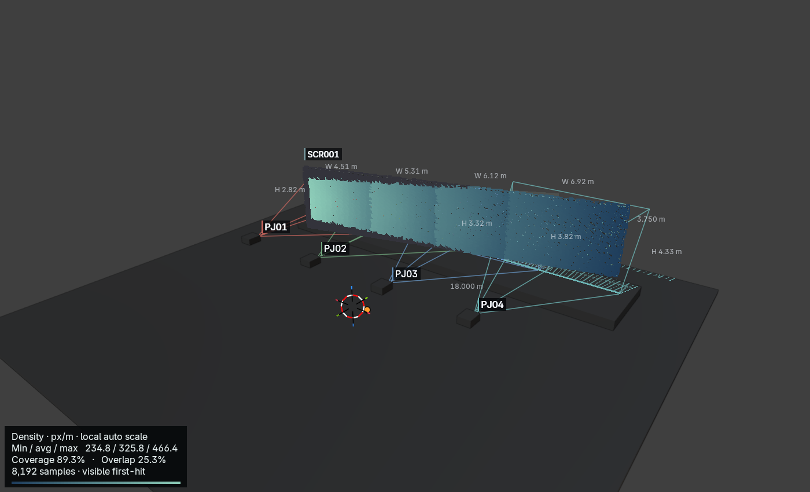
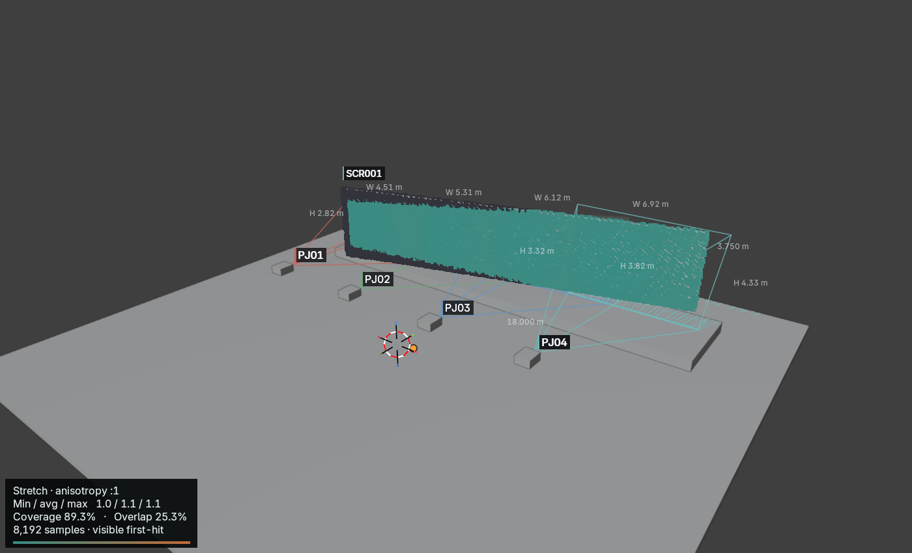

# Beam 0.12 — internal production beta readiness

Maintainer: **Twisted Pixel**. Assessment: **24 October 2026**. Candidate only: no tag, release publication or installation over the working Beam add-on. The recommendation applies to controlled internal use on the tested **Blender 5.2.2 LTS / Apple M5 Max / macOS Metal** configuration.

## Repository review and merge

The complete relevant 0.11 suite was rerun before [PR #5](https://github.com/twistedpixelpete/beam/pull/5) was marked ready and merged. Merge SHA: `9605e315ca2a58a11145917af053dd8261bed893`. Main was fast-forwarded and verified clean. Hardening then began on `feature/beam-internal-beta-hardening`. Repository ownership, protections, licensing and release settings are unchanged.

## PATCH: actual importer integration

The available PATCH source already had a `projection-study` 1.0 importer. The new `beam-study` 1.0.0 package was rejected. Work is isolated at `~/Documents/PATCH-Beam-Integration`, branch `feature/beam-study-package-import`, based on PATCH main `0140de7`; the active PATCH checkout and its unrelated uncommitted work were not modified.

[PATCH draft PR #29](https://github.com/twistedpixelpete/PATCH/pull/29), commit `19c0eecb677fa9c5a46c39cc52c73a89ba0f4a97`, extends the existing importer and adds a package summary to View Data. There is no Blender/Python dependency and no document-template system. Package records preserve unknown additive data for Documents; images embed into the portable project.

**Actual import performed through PATCH's application importer (`ProjectionStudyImporter.load`), in an automated native test.** The committed Beam 0.11 fixture loaded:

- 4 projectors with real Panasonic optics, SI calculations and fractional pixel-size values;
- 1 screen, 1 Blend Group, 4 optics records and 1 surface analysis;
- 3 embedded view images: Overview, Density and Stretch;
- project/venue/revision, UUID relationships, warnings and assumptions.

Nine malformed package cases reject: schema version, invalid UUID, duplicate UUID, dangling anchor, traversal, missing image, wrong image hash, missing analysis-image metadata and incorrect internal units. Unknown additive data is accepted. Images/data survive portable project save/reopen. Legacy Beam import and Documents tests pass. All paths are constrained inside the package after resolving symlinks; aggregate/individual image limits apply. Warning `sourceUUID` can identify non-projector entities. Imported data remains available for future screen/blend/analysis document blocks without inventing a new layout engine.

[Machine-readable import evidence](../examples/hardening/patch-import-evidence.json). The portable imported PATCH project is retained in `work/hardening/patch-import/Imported-Beam.patch`. Native PATCH and PatchChecks both build. **A manual GUI import was not performed**; the integration branch remains a draft PR. No production PATCH storage, My Library or installed app was changed.

## Optics additions and research

New conventional lenses:

| Fixture | Throw ratio | Source |
|---|---:|---|
| Panasonic ET-DLE105 | 0.978–1.32 | [RZ990series_G2, April 2022, p2](https://docs.connect.panasonic.com/projector/download/catalog/pdf/PT_RZ990_S_2P_ctlg_Eng_PC.pdf) |
| Panasonic ET-DLE250 | 2.27–3.62 | Same official series table |
| Barco GC 2.0–4.0 | 2.0–4.0 | [G100-W22, 18 September 2026, p2](https://assets.barco.com/m/65f051bcac7e2970/original/G100-W22-en-Spec-sheet.pdf) |

Added Panasonic **PT-RZ890**, native 1920×1200, **8500 lm normal ISO/IEC 21118:2020**, with the verified series lens choices (same Panasonic source, pp1–2). Library now has five real projector models and ten real lens entries, fourteen compatible model/lens combinations. Source revisions, checked dates and light-output basis remain explicit.

The [official Panasonic operating manual, pp77–78](https://eu.connect.panasonic.com/sites/default/files/media/document/2025-01/rz990_manual_en.pdf) was downloaded, extracted and visually inspected. Its H/V measurements use full image dimensions, but the diagram is a **coupled polygon** relative to the lens-mounter/home position; the manual distinguishes home from optical image centre. Independent rectangular limits would admit invalid corners. No speculative conversion was enabled. Shift source URLs and findings are recorded per Panasonic lens; nonzero shifted solves remain blocked where constraints are unknown.

UST/mirror examples explicitly listed as unsupported in `UNSUPPORTED_OPTICS`: Panasonic ET-DLE020, ET-DLE035 and Barco FLDX 0.38 UST 90°. They are not selectable as conventional pinhole lens presets. Generic manual settings do not imply validated UST behaviour.

## Production soak: bug found and fixed

The disposable venue contains **32 projectors, 8 Blend Groups, 8 screens and 114 scene objects**, including 288 curved auditorium seats, stage steps and trusses (32,968 venue vertices / 36,946 polygons). It includes real optics, labels/frustums, projection output, Reverse Mapping, Study Views and Surface Analysis.

A real failure occurred when duplicating a group with a real lens: recipes use sorted JSON keys, so `optics_lens` was restored before `optics_model`, while the dependent lens enum still allowed only Manual. The fix restores the model first, then remaining settings. Recipe restoration is now transactional: a deliberately invalid second-member lens leaves no partial group, objects or newly created orphan data, and restores selection/active state. Dedicated regression tests prove both the real-preset copy and failure rollback.

The completed manipulation run exercised **360 projector edits/rotations, 120 group moves, 60 overlap edits, 30 lens changes, 12 analyses and 12 Density/Stretch exports**. It also exercises projector/group duplication, Reflow, Auto Blend creation or atomic obstruction rejection, constrained inverse solving, receiver changes, Reverse Mapping refresh, Study View navigation, both CSV formats, Study Package export, native Undo/Redo and save/reopen.

Datablock counts across the repeated-edit phase were exactly stable: 114 objects, 51 meshes, 119 materials, 2 images, 1 node group and 42 cameras. These include temporary-workflow datablocks retained by Blender before the measured phase; zero growth is not a claim that Blender purges every unused datablock. Handler counts stayed stable and the registered runtime timer remained present. Projector UUIDs remained unique. [Detailed soak evidence](../examples/hardening/soak-result.json).

Initial/final 60-edit median costs stayed approximately 2.3 ms. Peak process RSS was about 0.85 GB, including Blender and renderer resources; it is not add-on-only memory. After explicit unregister/cleanup, Blender still reported **4 unfreed blocks / 0.001907 MB at process exit**. This small shutdown diagnostic is recorded, not concealed: allocation-level GPU/heap leak freedom is **not proven**. No growing datablock/resource count or interaction-time trend was observed during this soak.

## Analysis asset review

Four angled-receiver exports were rendered: Density/Stretch on light/dark geometry. Representative Density-dark and Stretch-light images were visually inspected. Text, samples and restrained palettes remain readable at 1400×850. The density legend now explicitly says **local auto scale** alongside numeric min/average/max, preventing an implication that separate studies share a scale. Existing structured scale metadata remains. No fixed-scale control was added: the current scope benefits from clear local scaling without another UI/configuration path.

The expected sampling gaps and 3:1 stretch colour saturation remain documented. No rainbow palette, giant legend or layout redesign was introduced.

## Designer edge cases and direct application status

Added **24 combined cases** spanning −/positive and extreme world translations (up to 200 km coordinate magnitude), strong pitch/yaw, near ±90° pitch, roll, wrapped angles, positive/negative shifts, landscape/portrait alternate raster, 37.25% brightness with stacking, and throw ratios 0.1 / 8.5. Exported/reconstructed matrices remain within the documented near-gimbal tolerance and CSV output is deterministic. These are internal tests, not new external claims. The existing ten actual Mapping Matter import/re-export fixtures continue passing.

**Designer application not available for direct validation.** No installation was found in the available applications. Compatibility remains limited to the tested Mapping Matter Designer-CSV importer; no actual Designer import is claimed.

## Save/version and migration safety

Five existing scene generations were loaded: 0.4, 0.6, 0.8, 0.9 and the 0.11 PATCH fixture. Originals were never overwritten. Disposable copies preserve projector/group/screen UUIDs, model/lens IDs, Study Views, project metadata, analysis configuration and intended active/pinned context. Older optics default to Generic/Manual; older views default to no analysis overlay. Sample caches are empty after reopening. Export convention IDs stay distinct and unchanged; no old CSV file is relabelled. [Migration evidence](../examples/hardening/migration-result.json).

## Performance against 0.11

Same benchmark scripts, hardware and dimensions. Three repetitions per operation (ten idle), median/max, CPU wall-clock updates/submission; **not FPS or GPU-completed interaction latency**. Overlap caches are cleared for each recalculation. Analysis is explicit. Reopen benefits from OS file caching. Absolute figures are workload-specific.

| Projectors | Operation | 0.11 median / max ms | 0.12 median / max ms |
|---:|---|---:|---:|
| 16 | idle update | 0.37 / 0.41 | 0.38 / 0.41 |
| 16 | projector transform refresh | 1.04 / 1.17 | 1.04 / 1.16 |
| 16 | blend overlap recalculation | 0.81 / 0.95 | 0.80 / 0.97 |
| 16 | multi group movement | 1.66 / 1.68 | 1.66 / 1.67 |
| 16 | analysis 512 | 23.93 / 23.96 | 24.00 / 24.07 |
| 16 | analysis 2048 | 88.33 / 97.59 | 90.92 / 99.65 |
| 16 | analysis 8192 | 350.68 / 353.25 | 355.67 / 358.09 |
| 16 | reverse mapping refresh | 1.34 / 6.33 | 1.43 / 5.58 |
| 16 | study view export | 169.28 / 245.63 | 179.62 / 240.96 |
| 16 | study package export | 221.65 / 222.48 | 224.22 / 225.15 |
| 16 | save | 15.13 / 21.72 | 15.39 / 22.27 |
| 16 | reopen and rebuild | 56.99 / 63.70 | 63.40 / 64.36 |
| 32 | idle update | 1.04 / 1.08 | 1.01 / 1.09 |
| 32 | projector transform refresh | 2.41 / 2.56 | 2.43 / 2.67 |
| 32 | blend overlap recalculation | 1.57 / 1.63 | 1.48 / 1.56 |
| 32 | multi group movement | 4.07 / 4.10 | 3.95 / 3.96 |
| 32 | analysis 512 | 41.67 / 43.49 | 41.21 / 41.41 |
| 32 | analysis 2048 | 153.82 / 156.09 | 150.94 / 152.43 |
| 32 | analysis 8192 | 591.86 / 613.64 | 596.97 / 605.62 |
| 32 | reverse mapping refresh | 2.90 / 9.59 | 2.79 / 50.49 |
| 32 | study view export | 206.18 / 211.08 | 181.04 / 214.18 |
| 32 | study package export | 243.99 / 249.35 | 235.45 / 239.84 |
| 32 | save | 20.74 / 25.31 | 16.87 / 21.87 |
| 32 | reopen and rebuild | 62.26 / 64.98 | 59.84 / 60.16 |

Normal interaction medians changed by only a few percent; no sustained interaction regression or speculative optimisation was identified. The 32-projector Reverse Mapping maximum increased from 9.59 to 50.49 ms despite a slightly lower median; this isolated tail-latency sample remains visible and warrants monitoring in longer sessions. Full raw timings are in `examples/production/benchmark-timings.json` and `examples/hardening/benchmark-after.json`.

## Exact validation results

- **55/55** standalone Python tests pass.
- **Blender milestones 1–15 pass**, including projection maths, GPU depth/output, exports, Undo/Redo and persistence; actual result file checked.
- **13 background suites pass:** `blender_review_regressions`, `blender_planning_milestone`, `blender_group_lifecycle`, `blender_frustum_helpers`, `blender_json_contract`, `blender_screen_builder`, `blender_screen_edges`, `blender_screen_beauty`, `blender_ui_context`, `blender_theme`, `blender_parity`, `blender_production`, `blender_surface_production`.
- Theme/refinement **Apply and Restore pass** in separate processes; native workspace and engineering GPU suites pass (result files checked).
- New hardening **24-case interop edge**, **real-optics duplicate/rollback**, and **five-generation migration** suites pass.
- Production soak, four analysis-quality images, 16/32 benchmark and fresh-process reopen checks pass.
- Beam/PATCH JSON schema and image/reference validation pass. Existing fixture images and hashes remain unchanged.
- PATCH **`--beam-package-check`, `--beam-study-check`, `--documents-check` pass**; both PatchChecks and the native PATCH target build. Only pre-existing toolchain search-path/deprecation warnings were emitted.

## Readiness matrix

All READY assessments are scoped to the tested macOS/Blender configuration and controlled internal use.

| Area | Assessment | Practical limit |
|---|---|---|
| Core projection | READY WITH LIMITATIONS | Pinhole/opaque evaluated geometry; no UST/mirror or photometric certification |
| Projector editing | READY | Transactional inverse constraints and native Undo/Redo tested |
| Blend Groups | READY | Real-preset duplication fixed and rollback covered |
| Auto Blend | READY WITH LIMITATIONS | Flat screens, current model constraints and obstruction checks |
| Reverse Mapping | READY WITH LIMITATIONS | Up to 32 coverage sources; GPU/UV/material assumptions |
| Surface Analysis | READY WITH LIMITATIONS | Explicit sampled estimate; gaps/thin features and transparency limits |
| Optics guidance | READY WITH LIMITATIONS | Five real models / ten lenses; unknown coupled shifts remain blocked |
| Study Views | READY WITH LIMITATIONS | GPU viewport required; transient analysis must be regenerated |
| Mapping Matter CSV | READY | Controlled numerical fixtures and established convention |
| Designer CSV | READY WITH LIMITATIONS | Actual Mapping Matter importer tested; Designer application NOT VALIDATED |
| PATCH handoff | READY WITH LIMITATIONS | Actual application importer tests pass; integration PR unmerged, manual GUI acceptance outstanding |
| Save/reopen | READY | Current soak and five scene generations; originals preserved |
| Production performance | READY WITH LIMITATIONS | 16/32 venue benchmark and short scripted soak only; tiny shutdown allocation diagnostic remains |
| Windows/Linux support | NOT VALIDATED | No matching environment available |

## Recommendation

**Recommend advancing to a controlled Internal Production Beta**, once the Beam hardening and PATCH integration PRs are reviewed/accepted. Keep the label beta, restrict initial use to the tested macOS/Blender setup, retain backups and independently verify installation studies. This is not a stable/public-release recommendation.

Remaining gates are concrete: manual PATCH Documents import/use, direct Designer application import on a suitable system, Windows/Linux validation, and a longer real-user production session with allocation-level profiling of the small Blender shutdown diagnostic. These are validation gaps, not invitations to add speculative features. No public release or tag was created.
