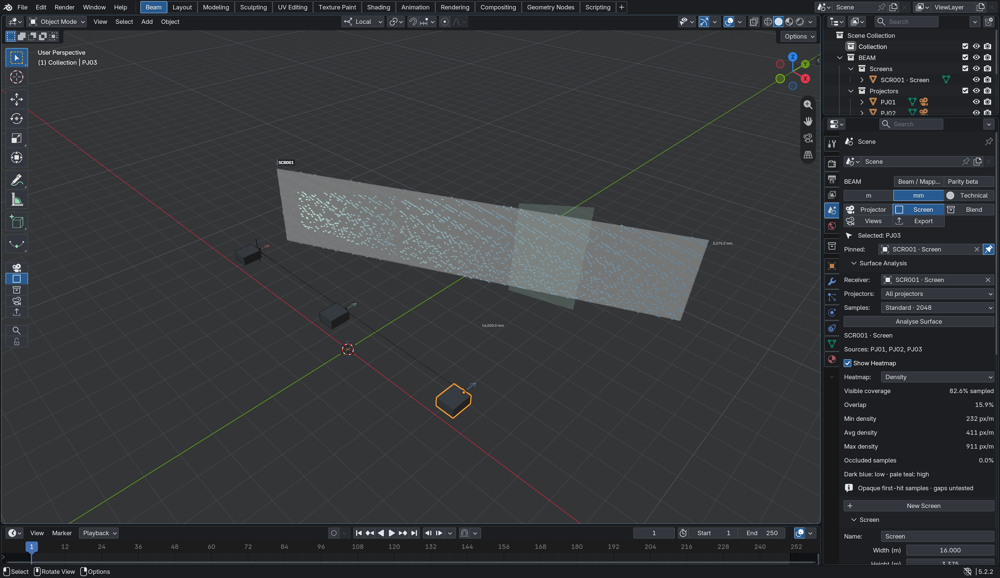
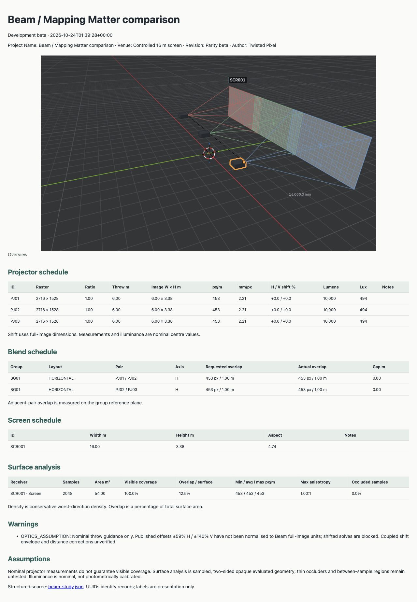

# Beam 0.10 — Mapping Matter validation milestone

**Development beta, still in testing. Maintainer: Twisted Pixel.** Verified 24 October 2026 with Blender 5.2.2 LTS / macOS Metal and the authenticated Mapping Matter project. This is a scoped comparison, not a claim of overall product parity.

## Delivery and sequence

The UI milestone was reviewed and merged first: [PR #3](https://github.com/twistedpixelpete/beam/pull/3), merge and final main SHA `87598d548d0373e044afbed9a0a7147d16a23a88`. The UI blocker fixes are commit `2134e0f82503248f1960487057562c465e6ea7c2` (visible module navigation and searchable workspace operator). Main was clean. The existing owner-only main ruleset was preserved; the authenticated owner used its allowed bypass to merge.

All engineering below is on `feature/beam-mapping-matter-parity`, based on that merge. It is not merged into main or published as a release. The downloadable 0.8.1 beta is unchanged.

## Use the new tools

1. Open **Beam → Projector, Screen or Blend → Surface Analysis**. Choose the receiver mesh and **All projectors**, **Active projector**, or **Active Blend Group**. Choose 512, 2048 or 8192 samples and click **Analyse Surface**.
2. Switch **Density / Stretch** to inspect cached sample colours. Dark blue to pale teal means low to high density *within this result*. Teal to amber means 1:1 to 3:1 pixel anisotropy. Grey means no visible projection at that sample. The density scale is automatic, so colours alone cannot compare two studies. Numeric min/average/max provide that comparison.
3. After an engineering edit, click **Analyse Surface** again. Stale overlays are hidden. Cache is transient; reopening a file requires analysis again. Results identify the receiver and the projector labels actually analysed, even if selection subsequently changes. Only the most recent receiver analysis is retained per scene.
4. Under **Projector → Optics Guidance**, choose a model and compatible lens, then **Use Preset Values** to explicitly apply resolution and lumens. Generic / Manual remains the default. Out-of-range input stays visible; solving and Auto Blend reject it instead of silently clamping.
5. Set project metadata in **Export**, create named **Study Views**, then **Export Study Package** to a **new folder**. The folder contains `beam-study.json`, `index.html` and `views/view-<UUID>.png`. Open `index.html` in a browser. Rendered views require a GPU viewport. Disabling view rendering exports metadata and a warning instead.

## What was inspected live

The existing comparison scene contained a 16 × 3.375 m screen, three Christie 4K10-HS projectors, and a Study Overview camera. Temporary projector/screen copies and one temporary box were used. They were removed after measurement; the original screen transform/visibility and original three projectors were restored. No save or publish action was taken. The failed import created no objects. [Restored scene](../examples/parity/evidence/mm-restored.jpg).

Inspected workflows:

- Pixel Density heat-map, Pixel Stretch, linear/log scale, min/max controls, automatic range, global and per-surface coverage/overlap/density statistics.
- Nominal projector information: image dimensions, distance, DPI, lumens and lux. The photometric toolbar was observed; no spatial illumination parity test was performed.
- Native/alternate raster selection, model/lens selection, short-zoom range, H/V shift labels, invalid throw input, custom projector/lens editor and project/organisation library scope.
- PDF Layouts: A4 landscape, cover/overview/projector-list pages, title block, margins, accent, hero view, repeat/template controls, image/annotation/legend settings. Scene metadata and export menus for PDF, camera images, projector images, viewport PNG and geometry. No new Mapping Matter PDF was generated or evaluated.
- Projector CSV export for ten controlled fixtures, and the actual **Import → Projectors from Designer CSV** workflow with Beam's combined-rotation export.

Evidence: [flat density](../examples/parity/evidence/mm-baseline-density.jpg), [flat stretch](../examples/parity/evidence/mm-baseline-stretch.jpg), [angled density](../examples/parity/evidence/mm-angled-density.jpg), [angled stretch](../examples/parity/evidence/mm-angled-stretch.jpg), [occluder](../examples/parity/evidence/mm-occluder.jpg), [reporting](../examples/parity/evidence/mm-reporting.jpg), [combined projector](../examples/parity/evidence/mm-combined.jpg).

## Controlled surface comparison

World Z is up. Neutral projectors look along +Y. Screen centre `(0,6,1.6875)` m; width 16 m; height 3.375 m. Projector positions `(-5,0,1.6875)`, `(0,0,1.6875)`, `(5,0,1.6875)` m. All have 2716 × 1528 native raster, ratio 1, zero shift, 10,000 ANSI lumens. The angled case rotates the receiver 25° about world Z around its centre (Mapping Matter plane rotation XYZ = 90°,25°,0°). The blocker is a 2 × 0.1 × 4 m box centred at `(0,3,1.6875)` m. Beam uses 8192 samples for flat/angled, 4096 for blocked.

| Metric / fixture | Mapping Matter | Beam | Difference | Notes |
|---|---:|---:|---:|---|
| Flat nominal width / height | 6 / 3.37555 m | 6 / 3.37555 m | float precision | Native raster aspect, not exact 16:9 |
| Flat nominal lux | 494 | 493.75 | display rounding | Not photometric validation |
| Flat density min / avg / max | 453 / 453 / 453 px/m | 452.67 / 452.67 / 452.67 | display rounding | Analytic `2716 / 6` |
| Flat coverage | 100% | 100% | 0 pp | All 54 m² |
| Flat overlap | 12% | 12.54% | 0.54 pp | Exact planar result 12.5%; sampling and display rounding |
| Flat stretch | 0–15%, avg 5% | anisotropy 1:1 throughout | not comparable | MM metric is not Beam's local differential anisotropy |
| Angled coverage | 83% | 82.53% | −0.47 pp | Sampling and integer display |
| Angled overlap / covered area | 19% | 19.02% | +0.02 pp | Beam also exposes 15.70% of **total** area |
| Angled density min / avg / max | 260 / 463 / 965 px/m | 231.78 / 410.34 / 909.92 | −28.22 / −52.66 / −55.08 | Definitions differ; Beam reports worst principal direction |
| Angled stretch | 0–64%, avg 14% | max anisotropy 1.47:1 | not comparable | Do not translate percent stretch to anisotropy |
| Blocked screen coverage | 100% | 74.98% | −25.02 pp | MM explicitly assumes clear line of sight; Beam casts first-hit rays |
| Blocked screen density | 453 px/m | 452.67 px/m on visible samples | display rounding | Excludes uncovered samples from average |
| Blocked samples | not accounted for | 1025 / 4096, 25.02% | intentional | Counts nominally covered samples with **no** visible source |

Machine results: [flat](../examples/parity/baseline-analysis.json), [angled](../examples/parity/angled-analysis.json), [blocked](../examples/parity/occluded-analysis.json). Small changes with sample count are expected. Native screenshots use 2048 samples, so their rounded values need not equal the 8192-sample table.

Beam also tested a two-depth stepped receiver (one half at Y=6 m, the other at Y=8 m). No corresponding live Mapping Matter stepped/curved test was performed; these remain **Not Yet Validated** against the reference.

## Surface maths and assumptions

`surface_analysis.py` is pure Python; `analysis_runtime.py` adapts evaluated Blender geometry and caches the result; `analysis_ui.py` draws cached GPU batches only.

At each sample, transform its position and tangent normal into the rigid projector frame. Clip against shifted raster UV bounds. Write the perspective ray as `q=(x/depth,y/depth,-1)`. For one horizontal or vertical raster pixel, the ray differential is `dq=(1/(ratio × resolution_x),0,0)` or its Y equivalent. Differentiating the ray/plane intersection gives:

`dP = depth × (dq − q × dot(normal,dq)/dot(normal,q))`.

The two columns form a 3×2 Jacobian in metres/pixel. Singular values give major/minor pixel pitch. Report width/height differential lengths, area density, `density = 1 / major_pitch`, `anisotropy = major_pitch / minor_pitch`, incidence angle, and relative major-pitch stretch against nominal centre density. A missing centre hit produces a null reference, not a preview-distance measurement. Unit tests compare perpendicular/60° analytic results and an independently intersected finite difference.

Triangles are sampled using equal-area systematic strata over cumulative evaluated triangle area and deterministic barycentric points. Each sample represents total area / count. This is a sampled estimate, not exact integration, a confidence interval, or adaptive error bound. Thin features and areas between samples can be missed. Concave, curved and disconnected meshes are processed as evaluated triangles; no curved-reference accuracy claim is made.

Nominal coverage means raster containment before blockers. Visible coverage additionally requires the first CPU BVH hit to coincide with the sample. This is **not the GPU depth map**. It treats surfaces as opaque and two-sided; transparent materials are opaque. Hidden/excluded geometry, projector bodies, Beam helpers and screen decorative details are excluded consistently with the shared receiver geometry cache. Instances are included by the shared evaluated geometry cache. Area includes the selected mesh's triangles, so closed objects include their back surfaces too.

In overlaps, density statistics choose the best conservative density among visible projectors; stretch follows that same selected source. Beam does not independently choose the least-stretched source, unlike the live Mapping Matter display. Occluded sample count means nominally covered but blocked from **all** eligible sources. Overlap includes samples visible to at least two sources. Density min/max/average use covered samples only. Variation is `(max−min)/average × 100`. Both total-area and covered-area overlap denominators are exported.

Analysis is explicit and synchronous. Geometry/projector edits, unit changes, receiver visibility/membership changes and analysis settings invalidate results; undo/load clear them. Normal drawing does no raycasting. One cached result per scene is retained; dense sample arrays are not serialized into the study package. View images currently show ordinary projection, not the analysis point overlay; statistics are included separately.

## CSV: established boundary and remaining incompatibility

Ten **actual Mapping Matter exports** are committed under [tests/fixtures/mapping_matter](../tests/fixtures/mapping_matter/README.md), with equivalent [Beam exports](../examples/parity/beam-csv/) and [numeric differences](../examples/parity/csv-comparison.json). Tested neutral orientation, all-axis translation, individual pitch/yaw/roll, combined rotation, H shift, V shift, combined shifts, ratio 0.9 versus 1.0, differing throw distances and 1920×1200 alternate raster. The maximum numeric error across checked fields was below **0.0016** (mm for lengths, degrees for angles); the acceptance tolerance is 0.02. This is floating-point agreement for these fixtures, not a hardware accuracy claim.

Central convention: **`beam_mapping_matter_transform_v1`**, in `transform_conversion.py`:

- Shared world XYZ, Z up. Positions and target dimensions in mm; angles in degrees.
- Neutral MM optical forward +Y and up +Z. Beam local forward −Z and up +Y; base orientation `Rx(90°)`.
- `R_MM = Rz(yaw) × Rx(pitch) × Ry(roll)`. Strip Beam's base orientation before extracting Blender `YXZ` Euler; output X as pitch, Z as yaw, Y as roll.
- MM shift percentages use half-image dimensions: CSV H/V = **2 × Beam H/V**. Signs agree in controlled positive-H, positive-V and combined negative-V examples. Beam's internal and authoritative JSON shift units remain full-image percentages.
- CSV target is the virtual point along the optical axis at the shifted centre-hit **axial depth**. It is not the shifted physical hit. Beam JSON `target.point_m` remains the actual physical first hit.
- CSV headers remain exactly the established Mapping Matter export headers, including legacy spelling. Exporter version advances to 1.1.0; authoritative JSON schema remains 1.0.0 with additive convention metadata.

Combined fixture: lens `(1234,2345,789)` mm, pitch 11°, yaw 23°, roll 17°, ratio 0.9, MM H +18%, V −24% (Beam +9%, −12%). Reference CSV target `(-241.474678,5821.000512,1523.016829)` mm; axial distance 3846.867010 mm; image 4274.296678 × 2404.685318 mm. This asymmetric rotated/shifted case distinguishes rotation order, signs and target semantics.

**Actual Beam → Mapping Matter import was attempted and rejected.** Its “Projectors from Designer CSV” importer expects another schema (`Name`, `Position X (m)`, `Rotation X (deg)`, etc.), not the headers from its own projector export. It reported “No projectors were imported.” No production object changed. We did not invent an adapter or claim a successful round trip. [Exact rejection](../examples/parity/evidence/beam-import-rejected.jpg).

`mapping_matter_reference_validated=true` explicitly means fixture/geometry agreement. `validated=false` continues to mean **Designer import unverified**. Gimbal-boundary/wrapped-angle equivalents and other Designer versions are untested. Older Beam CSV rotation, shift and target semantics change at this version; consumers must inspect convention ID and must not reinterpret old exports as v1. Blender scene transforms/projection behaviour are unchanged.

## Study package and PATCH handoff

[Sample HTML sheet](../examples/parity/study-package/index.html) · [sample JSON](../examples/parity/study-package/beam-study.json) · [portable JSON Schema](beam-study-schema-v1.json).

The `beam-study` 1.0.0 document includes project/venue/revision/client/author/export date, units, projector schedules, blend membership and adjacent-pair requested/actual overlap, screen schedules, named views, optics source/limits, current analysis summaries, warnings and assumptions. Notes and authoritative UUIDs are retained. Unknown/no-target values remain null. Screen dimensions are configured nominal dimensions; blend overlap is measured on the group reference plane, not arbitrary-surface overlap.

A consumer should validate schema/version, index records by UUID, resolve member/anchor/pair/receiver/source references, and use names only as display labels. Accept additive fields. Use explicit units; do not convert display mm into the already-metre geometry. Load view images only via package-relative `views/view-UUID.png`; a null path means metadata only. `validate()` rejects duplicate UUIDs, dangling references, non-finite JSON and unexpected image paths. The schema checks structure; application validation enforces cross-record relationships. The schema embeds the existing projector/group/view definitions for portability.

Exports write to a temporary sibling directory then rename into a new destination. Existing folders are refused. A failed export removes its temporary directory and restores view export metadata. Stale analysis is omitted with a warning instead of being silently reused. Current guidance thresholds are min density <100 px/m, coverage <99.5%, and anisotropy >2:1; these are explicit study thresholds, not universal content suitability limits.

Sample: PJ01–03 each have 2716×1528 raster, 6 m throw, 6×3.37555 m image, 452.67 px/m, 2.209 mm/px, 10,000 lm, nominal 493.75 lux. BG01 has two adjacent overlaps of about 452.67 px / 1 m. SCR001 is 16×3.375 m. Overview uses its UUID filename. The sample includes a real-preset optics-assumption warning.

PATCH can implement this file contract without importing Blender or coupling to Beam UI. **No actual PATCH Documents import was tested**, so this is a validated handoff format, not verified application integration. HTML is intentionally a small independent reader; no PDF layout engine was added.

## Optics guidance

`optics_library.py` contains immutable model/lens records; `optics_validation.py` is independent of runtime state. Models include manufacturer/model, native raster (aspect derived from raster), lumens and compatible lens IDs. Lens records include zoom range, optional H/V limits in **Beam full-image %**, restrictions and source. Model/lens IDs persist on projector settings and are copied into Auto Blend results. Generic / Manual preserves unrestricted manual use.

The small real fixture is Christie 4K10-HS, **2716×1528 native**, 10,000 **ANSI** lm, nominal 0.85–1.02 zoom. Source: [official Christie datasheet, July 2023, page 2](https://www.christiedigital.com/globalassets/resources/public/4k7-4k10-hs-datasheet.pdf), checked 24 October 2026. The datasheet distinguishes native raster from pixel-shifted 3840×2160 output. Beam's fixture uses the native raster explicitly. The real shift envelope is deliberately **unknown**: the sheet lists ±59% H / ±140% V, while the inspected MM entry shows ±60% H / ±140% V. Their physical convention, coupling and distance corrections have not been verified. Nonzero shifted solves with that lens are blocked; zero-shift nominal throw guidance is supported. This is not full real-lens calibration.

A clearly marked **TEST ONLY** synthetic 1080p fixture uses ratio 1.20–1.60, independent H ±25% and V ±55% in Beam units. It validates the constraint architecture; it is not manufacturer data. Tests cover valid values, both zoom bounds, H/V violations, raster mismatch, unknown real shift, achievable image-height solving, impossible solve rollback, and generated Auto Blend projector constraints.

Live MM clamped a ratio of 2.5 back to the lens maximum 1.02 and showed a near-limit warning. Beam intentionally retains invalid input and rejects a solve/layout with an explanation. Auto Blend validates and keeps the selected template ratio; it does not search a lens catalogue or optimise within a zoom range. General lens modes (coupled shift contours, UST/mirror geometry, image-circle restrictions) remain outside this implementation.

## Keep / match, improve, skip

- **Keep / match:** explicit density/stats tools, named review views, schedules, metadata, compatible model/lens choices, range feedback, predictable exported images.
- **Improve:** first-hit sampled coverage with transparent assumptions; stable UUID-based structured handoff; restrained palettes; explicit invalid-input feedback and transactional failure rather than silent clamp; separate nominal and visible metrics.
- **Skip:** rich cover/page designers, general document editing, giant scraped optics catalogues, photometric calibration, colour/black-level matching and a new web viewer. PATCH can own richer document composition.

## Honest parity matrix

Statuses apply only to the tested scope, not the whole product.

| Area | Mapping Matter | Beam | Status |
|---|---|---|---|
| Projector geometry | Controlled positions/orientations | Recreated all ten fixtures | On Par — tested cases |
| Throw maths | Nominal dimensions/distance | Matches within float precision | On Par — tested cases |
| Lens shift | Half-image CSV convention | Explicit 2× boundary conversion | On Par — tested shifts; real envelopes unverified |
| Pixel density | Reference density statistic | Worst-principal-direction metric | Not Comparable off-axis; flat case On Par |
| Stretch analysis | Percentage stretch | Differential anisotropy and pitch | Not Comparable |
| Coverage stats | Sampled nominal coverage | Sampled nominal + visible coverage | On Par for flat/angled unblocked cases |
| Occlusion analysis | Clear-line-of-sight assumption | CPU first-hit blocker test | Beam Ahead — tested opaque blocker only |
| Blends | Existing 3-projector overlap | Existing groups/Auto Blend | Not Yet Validated for layout-authoring parity |
| Overlap reporting | Covered-area denominator | Both denominators, pair schedules | On Par for tested spatial overlap |
| CSV transform | Export fixtures, separate Designer import schema | Numeric export match; import rejected | On Par for export values; import Not Yet Validated |
| Study reporting | Rich PDF layouts and image exports | JSON + HTML + named views | Mapping Matter Ahead for document layout; PATCH integration untested |
| Optics guidance | Large library, interactive range clamp | Small sourced/synthetic fixtures, constraints | Mapping Matter Ahead for library and real-lens envelopes |

## Validation and performance

- 55 pure Python tests pass, including six independent surface-maths tests.
- Blender integration milestones 1–15 pass; eight engineering acceptance scripts pass (review, planning, lifecycle, frustum, JSON, Screen Builder, screen edges and beauty).
- UI context/theme tests, two-process theme apply/restore, native workspace and existing GPU engineering/Reverse Mapping/undo/redo tests pass. The first theme-restore invocation omitted its required apply phase; rerunning the documented two-process workflow passed. No product fix was needed.
- New parity acceptance passes ten actual reference CSV fixtures; flat, angled, stepped and occluded geometry; cache visibility/transform invalidation; optics bounds, image-height solve, rollback and Auto Blend propagation; report duplicate/dangling UUID and overwrite refusal.
- Native Metal density/stretch overlays visually inspected, both flat and angled. Projection engine acceptance, current/saved-view export, Reverse Mapping save/reload and workspace restart also pass. New study export with actual view image, schedules, warning and analysis passes portable schema validation, including negative UUID/path/type/false-validation cases. HTML sheet visually inspected in browser.
- On the simple three-projector, two-triangle receiver, 8192-sample CPU analysis took about **0.13–0.15 s**; 4096 blocked samples about **0.07 s**. These are single-run observations, not large-venue benchmarks. GPU batch construction is additional; no continuous dense analysis runs during movement.

Reproduce with the test scripts in `tests/`, a disposable Blender process and isolated preferences. Pure tests: `python3 -m unittest discover -s tests -p 'test_*.py'`. Parity: Blender background `--python-exit-code 1 --python tests/blender_parity.py`; native overlay/package: interactive `--python tests/verify_parity_ui.py`. Schema checks: `python tests/validate_study_exports.py examples/parity/study-package/beam-study.json` with development dependency `jsonschema` (not an add-on dependency).

Remaining gaps: successful Designer/MM CSV import, actual PATCH import, MM stepped/curved comparison, exact off-axis reference density/stretch definitions, real shifted/coupled lens envelopes, illumination/photometric parity, gimbal boundary tests, large venues, Windows/Linux and Blender 4.5. Sampling can miss thin blockers. Analysis heatmaps are viewport point overlays, not exported view-image layers. This beta should remain in testing.
