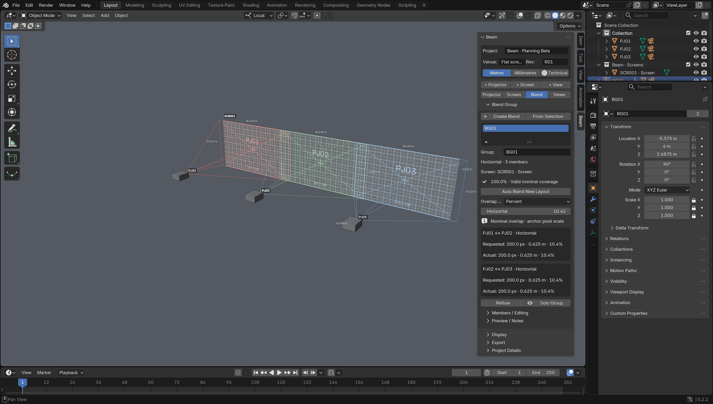
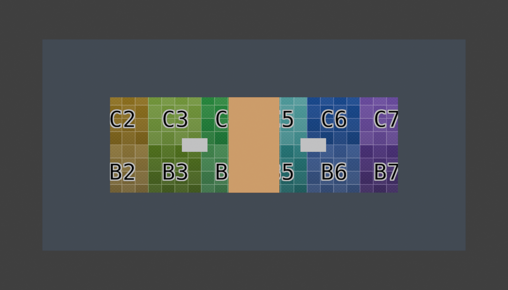

# Beam 0.9 planning milestone — feature beta

Maintainer: **Twisted Pixel**. This milestone is an unreleased, experimental beta and remains in testing. The published 0.8.1 beta is unchanged. Use copies of studies while evaluating 0.9.

## Set a projection target

1. Select a projector aimed at receiving geometry.
2. In **Beam → Projector → Calculated**, click the pencil beside Height, Width, Throw, Ratio, Density or Pixel Size, then inspect Solve By and the locks in Solver.
3. Edit the inline value. Apply with the checkmark to solve, or Cancel with X to discard the draft. Staging the value does not change the projector. The original **Set Projection Target** dialog remains available through operator search.
4. Check the calculated readouts and target. An invalid request reports a warning and restores the original state.

**Lens** keeps position fixed and adjusts throw ratio. **Position** holds throw ratio and orientation, moving along the optical axis. **Auto** chooses Position for distance or when the lens is locked; otherwise it chooses Lens. It is a deterministic choice, not a rigging optimiser. Position, lens and target locks are available. Resolution is always preserved. Native location locks are respected too.

Distance is Beam's existing axial centre-target depth, not slant distance. Position solving currently requires zero horizontal and vertical lens shift: with a shifted lens, keeping orientation, target position and optical-axis-only movement is generally incompatible. Beam reports this instead of moving sideways or silently changing aim. Lens solving with shift can change the centre target; leave Target locked to reject that change, or unlock it deliberately. Constrained projectors and non-unit/sheared transforms are rejected.

The original target dialog uses the m/mm display setting captured when it opens. Inline lengths use the captured m/mm display setting; inline pixel size is explicitly in mm. Density is px/m; ratio is dimensionless. The normal throw ratio control remains editable as before.

### Equations and architecture

The unchanged forward solver, `projection_math.calculate`, remains authoritative:

- `W = D / TR`; `H = W × Ry / Rx`
- `density = Rx / W`; `pixel_size = W / Rx`
- Desired height gives `W = H × Rx / Ry`.
- Desired density gives `W = Rx / density`.
- Desired pixel size gives `W = Rx × pixel_size`.
- Lens solve: `TR = D / W`. Position solve: `D = W × TR`.

`planning_math` contains pure scalar constraints. `inverse_solver` applies them transactionally and verifies the resulting forward measurements and first-hit target. Lens solves can iterate up to 16 times on angled targets; non-converging or blocked results roll back. Throw ratios remain within Beam's existing 0.05–100 range.

## Auto Blend

1. Create or select a **flat rectangular Beam Screen**, and click **Update Screen** if its parameters are pending.
2. Click **New Auto Blend** in the Screen inspector. Choose the active projector template or generic defaults.
3. Choose Horizontal, Vertical or Array. Enter a projector count, or columns and rows for an array. **Auto Count** searches for the smallest fitting arrangement at the entered throw distance.
4. Set horizontal/vertical overlap in pixels, percent or metres. The result updates as you edit; no objects are created during this calculation.
5. Review the result and each adjacent slot's overlap. Click **Create Layout**, or Cancel.
6. Select the resulting group to inspect each actual projector pair, requested/actual overlap, coverage and gaps. Move a member, change its optics, move the screen, or adjust group spacing: the readouts follow the current arrangement.

Physical overlap input is explicitly labelled in metres; result readouts use your m/mm preference. Pixel and percentage inputs are per single projector image. The preview uses numbered slots because final PJ identifiers are assigned at creation. Horizontal and vertical array overlaps are independent.

The result is a normal Blend Group with independently editable projectors, new UUIDs/PJ identifiers and separate Study Colours. Template resolution, throw ratio, lens shift, lumens, brightness, stack and output are copied. Template lens shift is compensated in the initial lens positions. Generic defaults use 1920 × 1080 and TR 1.0.

**Nominal coverage** means the union of projector footprints clipped to the flat screen, not illuminated pixel coverage after every possible obstruction. Creation checks every projector's centre ray for a first hit on the selected screen. Partially blocked corners and objects between centre rays still require viewport inspection. Reverse Mapping offers an occlusion-aware visual check.

### Layout algorithm

For columns `C`, rows `R`, fractional overlaps `fh/fv`, and image aspect `A = Ry/Rx`:

`W = max(screen_width / (C − (C−1)fh), screen_height / (A(R − (R−1)fv)))`

For physical overlap `oh/ov`, the required image width is:

`W = max((screen_width + (C−1)oh)/C, (screen_height + (R−1)ov)/(R×A))`

Without a fixed distance, throw is `W × TR`. At fixed throw, image size follows the forward solver. The grid is centred on the screen with equal spacing `W−oh` and `H−ov`. Auto Count searches increasing counts (up to 32), chooses the least overscan at the first valid count, then the smaller column count as a tie-break. It honours minimum/maximum throw, full nominal coverage and centre points remaining on the screen. It does not optimise manufacturer lenses, rigging or curved surfaces.

`layout_geometry` owns the shared flat-screen validation and frame contract; both creation and live measurements use it. Screens with missing faces, non-planar edits, modifiers or non-unit scale must be updated/restored first. Invalid projector scale is reported instead of contributing valid coverage.

`auto_layout` converts the scalar solution to screen-space transforms, validates first-hit centres, and creates the ordinary projector/group objects. Failed creation removes its objects and restores selection. `layout_coverage` projects current corner rays onto the attached screen plane, uses convex intersections for pairs and a polygon union for coverage. Results are cached by geometry, transforms and optics. Changing overlap units preserves the requested physical overlap using the current anchor footprint. Pixel/percentage readouts use the group's anchor projector scale; they are a nominal common-plane measure when members have different resolutions, rotations or optics.

## Reverse Mapping: reveal existing UV content

1. Select a receiving **mesh with UVs and node-based source materials**. Keep its normal texture/material setup.
2. Open **Reverse Mapping**. Choose Active Projector, a specific Selected Projector, a Blend Group, or All Active Projectors. For a group, use **Choose Blend Group**.
3. Choose a mode, then **Enable on Selected Mesh**. The viewport switches to Material Preview.
4. Move projectors or receiving/occluding geometry. Coverage updates while the original UV texture stays continuous.
5. Click **Restore Materials** to restore the original material assignments. Switching shading modes does not disable Reverse Mapping.

Modes:

| Mode | Outside coverage | Inside coverage |
|---|---|---|
| Covered Only | Neutral surface | Original material |
| Uncovered Dimmed | Adjustable dimmed original | Original material |
| Uncovered Hidden | Transparent | Original material |
| Overlap Diagnostic | Neutral surface | Original, amber where two or more sources overlap |

### Implementation and scope

The existing coverage engine supplies first-hit depth maps, including intervening geometry. A generated shader group evaluates each surface point in projector space, checks raster bounds and compares axial depth with that map. Masks combine as a union; a count greater than one drives overlap highlighting. The source material still evaluates with its own UV coordinates. Beam never reprojects its source texture.

Each material slot gets an object-level copy of its source shader graph with a coverage wrapper. Original datablocks, shared meshes and UVs remain unchanged. Restore matches wrappers by identity, so material-slot reordering/removal does not lose the original material references or slot link modes. Every resolved EEVEE/Cycles material output is wrapped. A material manually assigned over a wrapper is preserved on restore. Edits to source image pixels remain shared; after changing the source shader graph, restore and re-enable to copy the new graph. Source/mode changes rebuild wrappers; movement only updates cached coverage images and scalar optics. Unused generated materials, node groups and coverage images are removed on restoration. Receiver errors fail closed independently and do not stop other receivers refreshing. No per-frame texture baking is used. GPU depth readback occurs when the depth-map signature changes, not on every idle frame.

This first version supports up to 32 source projectors per receiver and requires a GPU viewport. Use Material Preview or Rendered viewport and Beam Study View PNG export. Packed masks preserve the last state in saved files, but **headless/final animation rendering is not a supported live-mask workflow**. Coverage resolution follows Beam's projection detail setting; small occlusion boundaries can show sampling/bias artifacts. More/larger masks cost memory and GPU readback time. Hidden uncovered geometry continues to participate in Beam's physical opaque-geometry occlusion model. It does not make a wall optically transparent.

The usual projected grid/image overlay is suppressed on Reverse Mapping receivers so it does not obscure the revealed UV content. Other receivers continue using normal projection. The projection engine, targeting and multi-surface behaviour are unchanged.

## Contextual interface

The compact project header contains project, revision, units and Technical/Presentation controls. Venue/client/author live in Project/Workspace. See the [workspace guide](UI-WORKSPACE.md) for the current navigation and inline target workflow. Contextual creation actions add a projector, screen or saved view. Projector, Screen, Blend, Views and Export tabs expose the relevant inspector, and selection follows the matching Beam object. Selecting venue geometry preserves Beam's active projector/screen/group context. Screen commands act on the screen shown in the inspector even when venue geometry is selected.

Calculated values now offer staged inline target edits with Apply/Cancel; DPI and estimated illuminance remain read-only; solve locks stay beside the target fields; display options, metadata and advanced details use collapsible sections. Blend results identify each axis and show requested versus actual px, physical units and percent. Existing Frame, Solo, Lock, Reflow, group-member and export actions remain available in context.

Recommended workspace: a large 3D View with the Beam sidebar open, an Outliner at upper right and a compact Properties editor below. Save this as a personal Blender workspace if useful. Beam does not replace or force a workspace.

## Persistence, migration and interchange

No migration command is required. Existing studies retain their projectors, legacy groups, screens, views, IDs and source materials. New properties have defaults; legacy groups without an attached Auto Blend screen retain their previous overlap measurement behaviour. Group duplication recipes carry the attached screen UUID. Save new studies separately during beta testing. Restore Reverse Mapping materials before intentionally moving a study back to an older Beam version; older code cannot manage the new wrappers.

CSV and the frozen PATCH JSON v1 core contract remain unchanged. For new Auto Blend groups, the existing group `measurement_plane` describes the actual attached screen plane, matching the adjacent-pair measurements. The reference plane still describes the last layout's nominal dimensions. No external PATCH importer or disguise Designer validation was added.

## Verification

Run tests only in disposable Blender sessions:

- Python: `python3 -m unittest discover -s tests -p 'test_*.py'`.
- Background Blender: `tests/blender_planning_milestone.py` covers all inverse fields/locks, parent transforms, angled targets, shifted-position refusal, three layout types/Auto Count, unique IDs/colours, live gaps/overlap, moving screens, templates, rollback and shared-material restoration.
- UI Blender: `tests/verify_planning_ui.py` exercises native Undo/Redo, renders every reverse mode, checks UV continuity and movement, and captures obstruction examples.
- Existing milestones 1–15, group lifecycle, JSON contract, helper termination and screen builder/edge/beauty scripts remain regression checks.

Manual acceptance: create a 16 × 3.375 m screen; generate three generic projectors with 200 px overlap; expect TR 1, 6 m throw, 6 × 3.375 m images and 0.625 m / 10.4167% overlap. Move the middle member 1 m sideways to produce a gap/incomplete coverage; Undo. Try a 6 m desired image height by Lens and 5 m distance by Position on a large flat target. On a UV chart, compare original, dimmed and overlap modes, move a projector and an occluder, then restore materials.

The [PR #2 engineering review](PR2-ENGINEERING-REVIEW.md) records the review fixes, current validation and an eight-projector performance sanity check.

## Next milestone

A focused beta validation pass on real venue models and Blender 4.5/Windows/Linux: profile interactive masking with 8–32 projectors, refine occlusion-edge bias and add explicit coverage quality feedback. Follow with shifted-lens position solving only after defining how optical-axis movement, aim and target locks should trade off. Avoid expanding into model databases or calibrated blending until these workflows are proven.
