# Beam theme and workspace — development beta

Maintainer: Twisted Pixel. Branch: `feature/beam-theme-workspace`, created from stable main `846d63a`. The prior tested native UI foundation is included because it has not yet merged into main. Still a prerelease, in testing.

Current refinement: [UI/UX refinement](UI-UX-REFINEMENT.md).

## Install and revert

1. Install the Beam extension ZIP using Blender **Preferences → Add-ons → Install from Disk**. Restart Blender after replacing an older build.
2. The theme is optional. Export your current customised theme first in **Preferences → Themes → Save Theme** if you want to preserve it as a preset.
3. In Beam's **Project / Workspace**, choose **Apply Beam Theme**, then confirm the application-wide change. This captures your current theme for **Restore Previous Theme**, including after restart. Alternatively install the separately supplied `Beam.xml` through **Preferences → Themes → Install**.
4. Applying the theme affects **all Blender workspaces and editors**. Installing the standalone XML also adds it to the native preset list. Blender's own Auto-Save Preferences setting determines persistence. Beam does not force preference saving.
5. To revert an Apply Beam Theme action, use **Restore Previous Theme**. For manually installed XML, select your previous theme (or Blender Dark) in Preferences → Themes. Uninstalling the add-on does not revert a separately installed theme.
6. Use F3 → **Open Beam Workspace** from a native Layout containing a 3D View, Outliner and Properties editor. Existing workspaces remain available.

Installing/enabling the extension, loading a study and opening the workspace never apply the theme automatically. The `.blend` does not carry the global theme. There is no projection-data or export-schema migration. Existing collection organisation remains opt-in.

Blender's [theme documentation](https://docs.blender.org/manual/en/4.4/editors/preferences/themes.html) describes the standard XML preset installation/export mechanism used here.

## Appearance

The original Beam preset uses charcoal surfaces, muted blue active controls, light neutral text and restrained teal status accents. It does not contain Eclipse files or assets. Eclipse's low-noise direction is only conceptual; the preset is generated from Blender factory semantic defaults with an original palette.

| Role | Colour |
|---|---|
| Editor background | `#20252A` |
| Header | `#1C2126` |
| Panel | `#24292F` |
| Input | `#353C44` |
| Active interaction | `#285B91` |
| Text | `#E3E7EB` |
| Native success background | `#326E60` |

Viewport colours stay neutral. Projector Study Colours and test-pattern materials are unchanged. Orange viewport selection remains Blender-native and visually distinct from blue Beam navigation; the textual Selected, Active/Pinned and Receiver labels make context explicit. Keyframe, animation, driver, warning/error and collection colours retain Blender's semantic defaults.

Native fonts, sizes, menus and editing workflows remain familiar. No font installation is required. Hover, disabled and focused appearances use Blender's widget drawing rules. Native confirmation buttons use the selected blue; secondary Beam actions remain neutral. No custom button shader or theme-driven engineering logic is introduced.

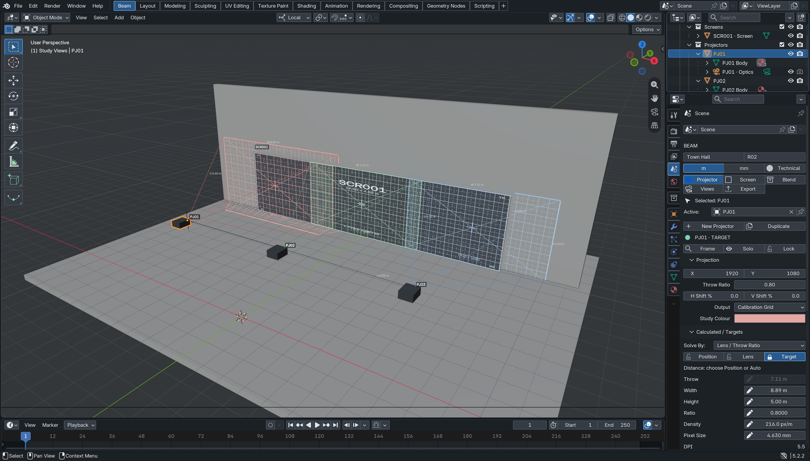

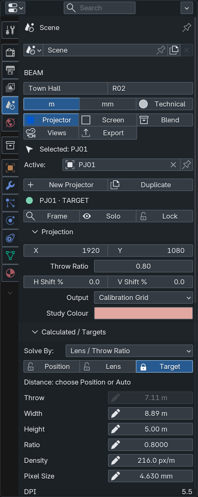

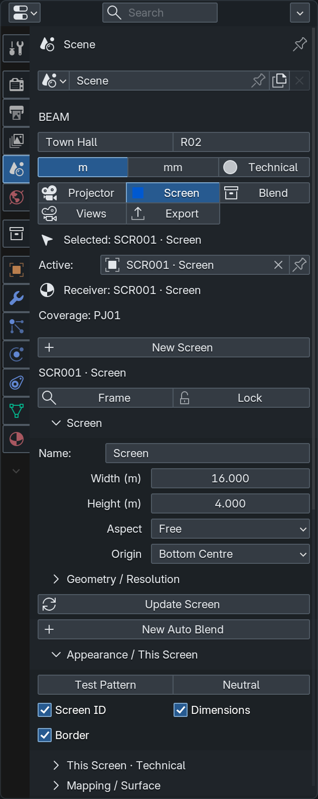

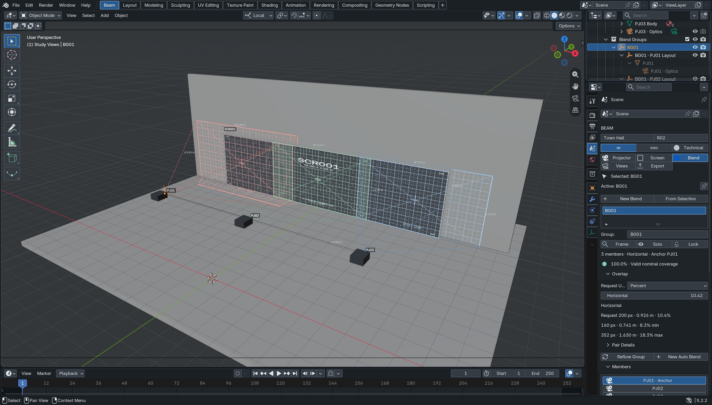

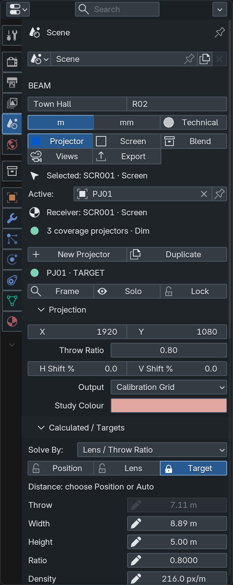

## Workspace and navigation

The optional workspace keeps a large native viewport, native Outliner at upper right and contextual Beam inspector below it. The compact five-module navigation lives in the viewport’s native toolbar, with an inspector fallback when that toolbar is hidden. Blender Python does not provide a custom editor registration API, so the rail uses the existing native toolbar rather than a substitute editor. Standard editing, transforms, materials and modifiers stay available.

Selection follows Projector, Screen, Blend and Study View objects; pinning holds Beam context while selecting venue geometry. Inline target editing, scoped annotations, cached overlap summaries and distinct New Auto Blend/Reflow actions are retained. See the [workspace guide](UI-WORKSPACE.md) for details.

## Validation and limits

Validated in disposable Blender 5.2.2 LTS sessions on macOS/Metal, using an isolated preferences directory. Your saved Blender preferences and installed add-on were not changed.

- Native XML theme load passed; register/unregister do not apply or revert the theme.
- Seventeen normal/selected text/background pairs meet at least 4.5:1 computed sRGB contrast. This covers standard buttons, fields, menus, tabs, lists and the active Outliner row; it is not a blanket accessibility certification. Disabled controls retain Blender's own fading.
- Warning/keyframe/animation/driver and viewport-selection colours are verified unchanged.
- The full native workspace acceptance suite passed with the theme: all modules, actual Outliner selection, pinning, receiver state, inline edits/Undo/Redo, Auto Blend and member actions, workspace switching/save/reopen, Presentation toggle and image export.
- Native Auto Blend, inverse solve, confirmation and export-file-browser dialogs were opened, captured and cancelled. A clearly labelled test fixture exercises enabled/disabled/invalid inputs and Blender's native colour picker.
- 49 standalone tests and seven Blender UI-context regressions passed again. The inherited workspace foundation's engineering/GPU tests are recorded separately in TEST_RESULTS; they were not all repeated for this palette-only increment.

Screenshots are actual Blender captures, not mockups. Monitor brightness, colour calibration, Windows/Linux and Blender 4.5 remain unverified. Checking low-brightness displays, hidden/linked object workflows and narrower laptop layouts with real users is recommended. Native per-workspace themes are not supported: the preset is application-wide. Theme shading/background may affect the appearance of viewport captures; UI chrome is not part of Beam's exported view image.

## Implementation

`projection_study/themes/Beam.xml` is the installable native preset. `tools/build_theme.py` reproducibly builds it inside a disposable factory Blender process. The UI now exposes an opt-in Apply/Restore adapter around Blender’s native XML preset loader; the refinement guide describes its persistent backup. No new theme timer, handlers or scene data are added.

The previous UI foundation is carried in commits `bfe2a35` and `408bf3d`. The theme increment changes no projection maths, inverse solver, Auto Blend, Reverse Mapping, Blend maths, CSV/JSON schema, UUID logic or test-pattern generation.

## Dialog and export gallery

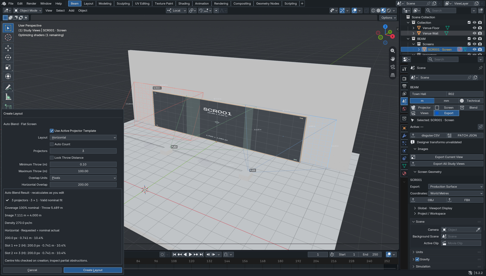

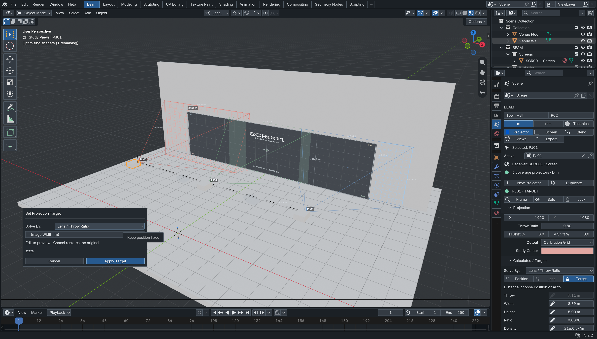

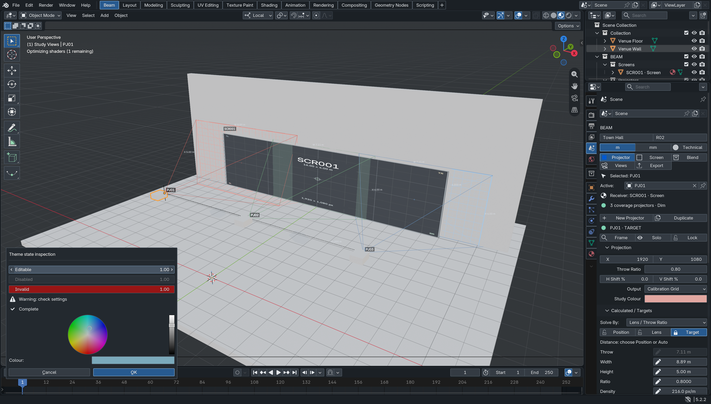

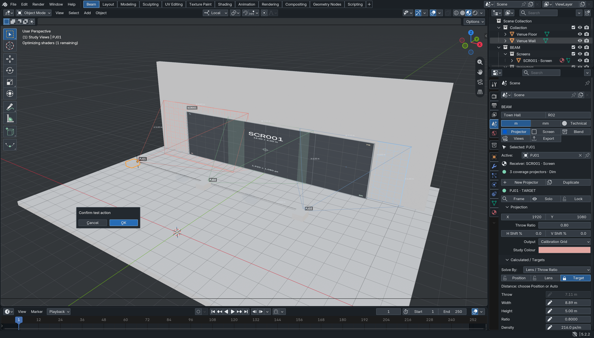

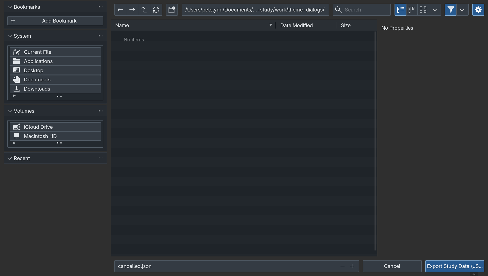

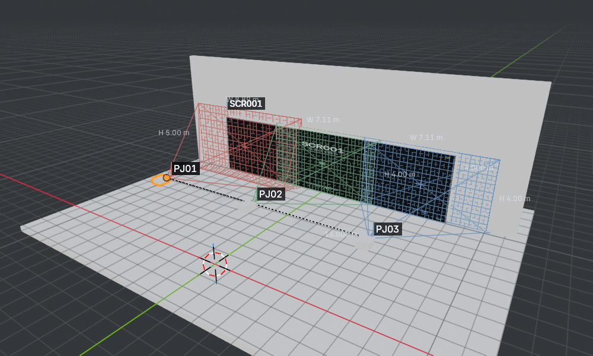
