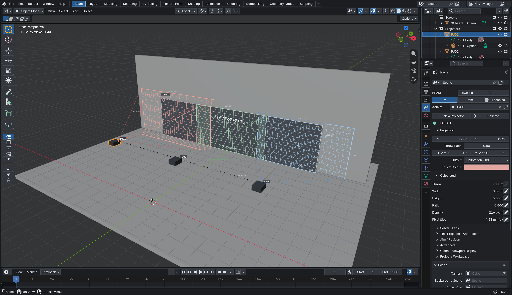
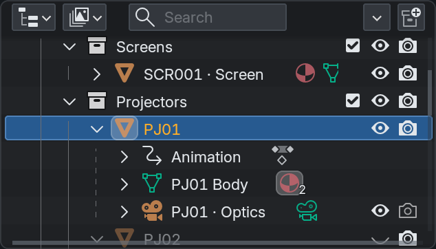
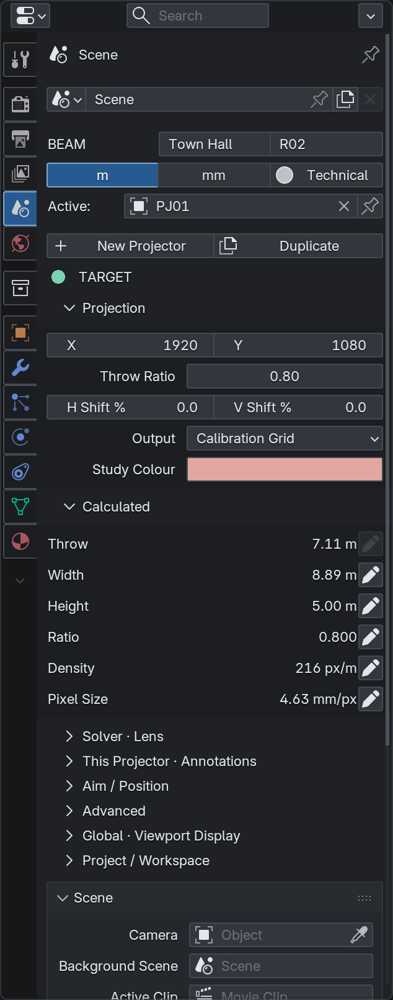
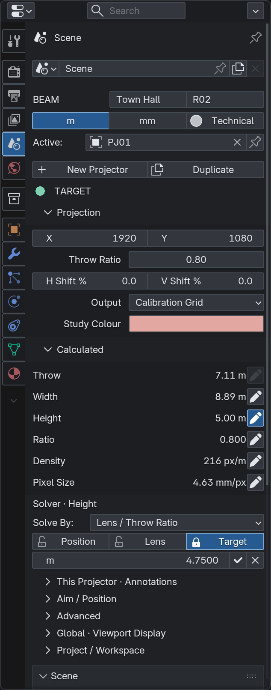
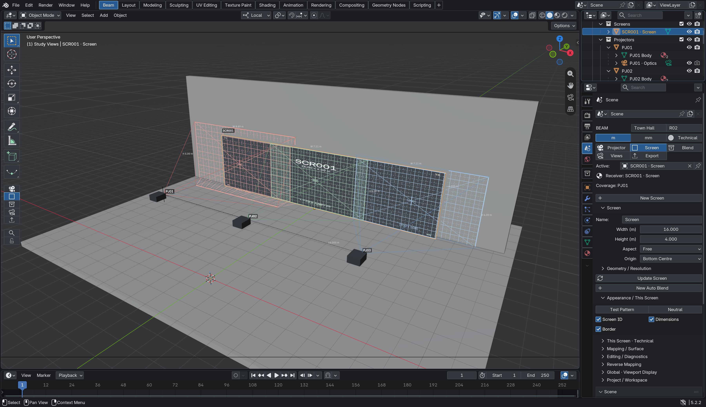
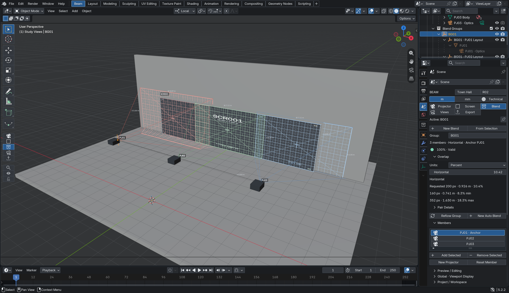
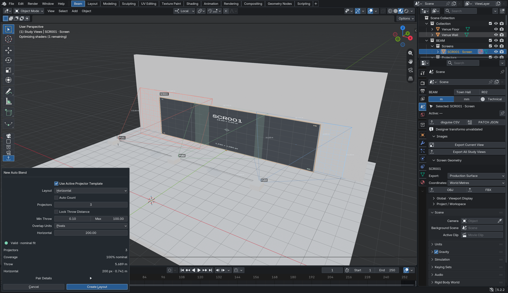
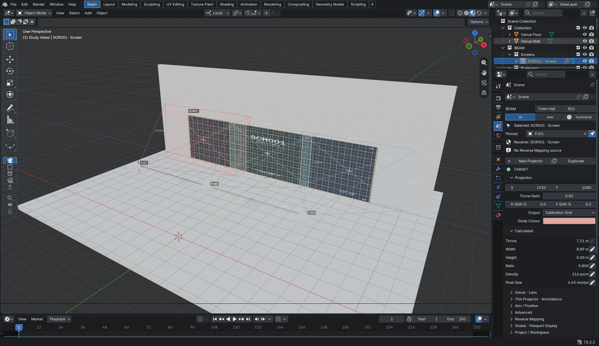
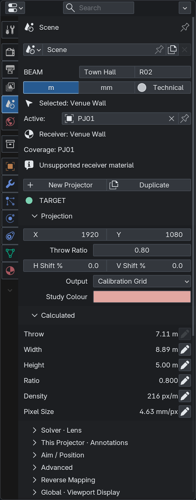
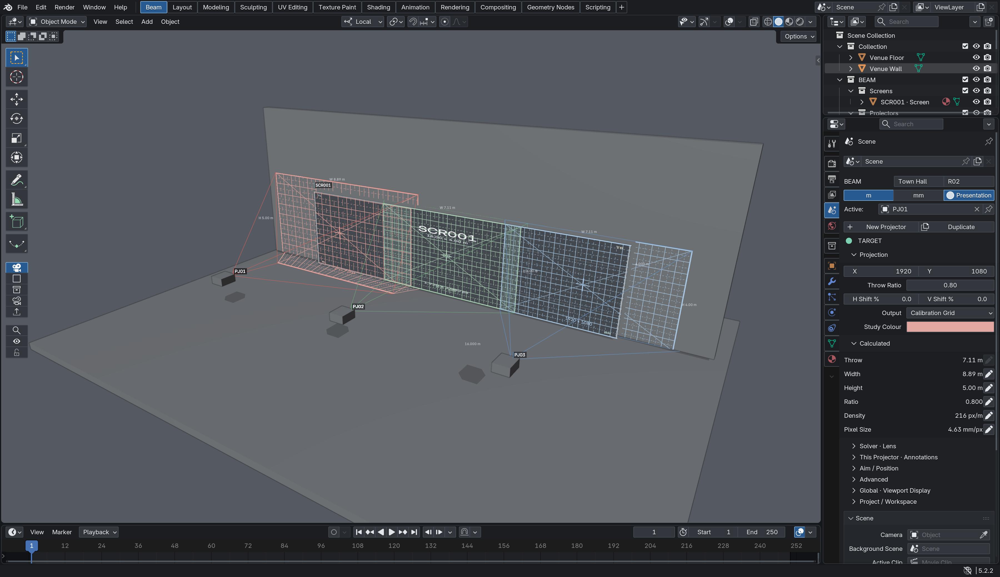

# Beam UI/UX refinement — development beta

> Historical milestone / test report. Its screenshots and validation claims describe that milestone. Use [Documentation Baseline](manual/DOCUMENTATION_BASELINE.md) for the current documentation build and current UI evidence.

Maintainer: Twisted Pixel. Branch: `feature/beam-ui-ux-refinement`, created from clean stable main `846d63a`. The prior tested UI/theme foundation is carried forward because it is not yet on main. This is an unreleased beta, still in testing.

## What changed

- A compact five-module rail lives in the native 3D View toolbar at the left. Native Blender tools remain above it. Frame/Solo/Lock appear beneath the module icons when applicable. Widen the toolbar for labels; narrow mode uses native icons and tooltips. Labelled module buttons also remain visible in the inspector for discoverability. Hide the toolbar with Blender's normal toggle and utility actions return to the inspector. Other workspaces keep the normal Beam sidebar.
- The project header uses two rows. Repeated IDs and unnecessary selection rows are removed: **Active** identifies Beam's context; a separate **Selected** row appears when native selection differs. **Pinned** and **Receiver** remain explicit and independent. Export has no irrelevant active-object block.
- Calculated measurements are plain, aligned text. Separate pencil buttons stage edits; disabled buttons expose restrictions in tooltips. Density is concise and pixel size is explicitly **mm/px**. Stored precision is unchanged.
- An active edit exposes **Solver**, with target value, Solve By, locks, Apply/Cancel and errors together. Idle Solver collapses to a short mode heading. Advanced photometric readouts are moved out of the common path. No Target is shown once.
- Screen identity is no longer repeated above its fields. The existing screen geometry, pattern, appearance and diagnostics tools remain intact.
- A compact **New Auto Blend** dialog presents count, nominal coverage, throw and overlap. Pair Details is opt-in. Its preview is cached before drawing and updated when inputs change. It delegates calculations and execution to the unchanged planner. **Reflow Group** remains a distinct action on the current group.
- A single Blend Group no longer occupies a redundant group list. Existing overlap summaries and collapsed Pair Details remain bounded; member controls stay in a short native list.
- Theme surfaces are more neutral, field outlines quieter and scrollbars clearer. Native icons replace the bright module marker. Orange selection, warnings/errors, animation/keyframe and collection semantics remain native; teal positive indicators remain sparse. Study Colours and test patterns are unchanged.

The [Eclipse page](https://extensions.blender.org/themes/eclipse/) was inspected as a visual reference for restraint and hierarchy. No Eclipse theme files or data were downloaded or copied. Beam retains its own blue/teal palette.

## Install, apply and restore

Install the beta add-on ZIP through Blender Preferences → Add-ons → Install from Disk, then restart Blender. From a Layout with Viewport, Outliner and Properties, use F3 → **Open Beam Workspace**. Existing workspaces are retained; repeated Open does not create another Beam workspace.

In **Project / Workspace**, choose **Apply Beam Theme**. Its dialog explicitly states that the change affects every Blender workspace. The first Apply captures the current theme and text styles into a theme-only backup under Blender's version-specific configuration directory (`beam_theme/previous.xml`). Repeat Apply keeps that original backup. **Restore Previous Theme** restores it, including after restarting Blender. After restoration, the next Apply captures the then-current theme.

Theme application is never automatic on add-on registration, file load or workspace opening. These operators do not call Save Preferences; Blender's Auto-Save Preferences setting or an explicit Save Preferences controls persistence of the applied theme. The backup itself is persistent. Theme restoration uses Blender's native XML colour precision. It does not touch keymaps, add-on settings, scene data or other preferences.

The standalone XML can still be installed through Preferences → Themes, but that native installation path does not create Beam's restore backup. Uninstalling the add-on does not automatically revert the global theme. Use Restore first, or select another preset in Blender's Themes preferences.

There is no engineering-data, UUID, material or export-schema migration. Existing study collections are only reorganised through the explicit Organise command. Save the `.blend` to persist the optional workspace layout; the application theme is stored separately in Blender preferences.

## Native screenshots

These are actual Blender captures from disposable test scenes, not design mockups.

## Architecture and boundaries

`ui.py`, `screen_ui.py` and `blend_ui.py` present native controls. `ui_workspace.py` supplies native context bridges and selection updates. `ui_planning.py` is a UI adapter over the existing Auto Blend calculate/execute functions; it does not implement a second planner. `ui_theme.py` handles explicit theme Apply/Restore and durable theme-only snapshots. `tools/build_theme.py` generates the original preset from factory semantic defaults.

No calculations, raycasts, geometry construction or coverage solves were added to panel drawing. The GUI harness forbids runtime refresh, coverage and pair computation while drawing; the new planning dialog additionally forbids planner calculation during draw. The UI timer remains approximately 0.04 ms per idle update in the test fixture; this is not a viewport FPS claim.

The projection and inverse maths, Auto Blend algorithm, Reverse Mapping/material logic, GPU depth system, CSV/JSON schemas and UUID algorithms are unchanged from reviewed main. The inherited UI foundation includes native collection routing at creation boundaries; it does not migrate existing studies on load.

## Validation

Test platform: Blender 5.2.2 LTS, macOS/Metal. Tests used disposable scenes and isolated preferences; the user's installed add-on and saved preferences were not changed.

- 49 standalone Python tests and seven UI-context tests passed.
- All eight engineering acceptance scripts passed, including ten engineering review regressions, planning, group lifecycle, frustum termination, frozen JSON contract and screen suites.
- Native workspace acceptance passed with the new planning and Reflow adapters: selection through Outliner, pinning/venue context, staged inverse edits, visible restrictions, native Undo/Redo, screen update, Auto Blend Undo/Redo, members, Reflow, save/reopen and PNG export.
- Fresh-process workspace reopening passed; repeated Open created no duplicates. Hidden toolbar navigation fallback, missing source, simulated GPU-unavailable warning and Presentation/Technical round trip passed.
- Custom theme Apply/Restore passed across separate Blender processes; repeat Apply preserved the original backup. Seventeen standard/selected text pairs passed 4.5:1 sRGB contrast, with native semantic state colours preserved.
- Native Auto Blend, inverse-solve, confirmation and export dialogs were captured and cancelled. The new Auto Blend result is present on first draw and no planner calculation occurs during drawing.

See [TEST_RESULTS](../TEST_RESULTS.txt) for the recorded checks.

## Limitations and follow-up

The rail is a panel within Blender's existing toolbar, below its native tools. Its width and available space follow Blender's region sizing. Native Scene/Properties chrome remains available. The theme is application-wide; independent per-workspace themes, arbitrary primary-button colours and custom per-panel fonts are not exposed by this approach. The blue applies to native active controls and dialog confirmation actions, while ordinary action buttons remain neutral.

Disabled-control fading and hover treatment are Blender-native. The measured text pairs do not certify all possible UI states or physical display brightness. Keyframed/hidden/render-disabled Outliner objects were captured in a fixture; monitor calibration and extensive production venue testing remain user-facing follow-up work. Blender 4.5, Windows/Linux and narrow laptop displays remain unverified.

Presentation keeps the existing neutral viewport behaviour and removes guides without changing the application theme. Further polish should focus on real venue sessions, discoverability of narrow rail icons and comfortable editor proportions at smaller resolutions.
