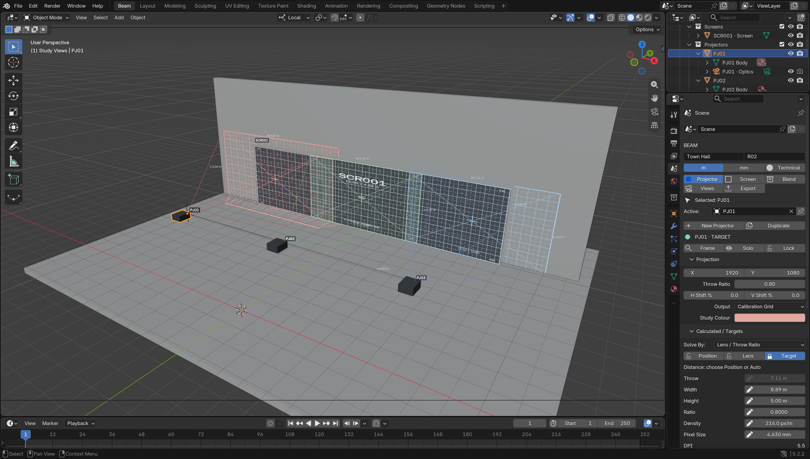
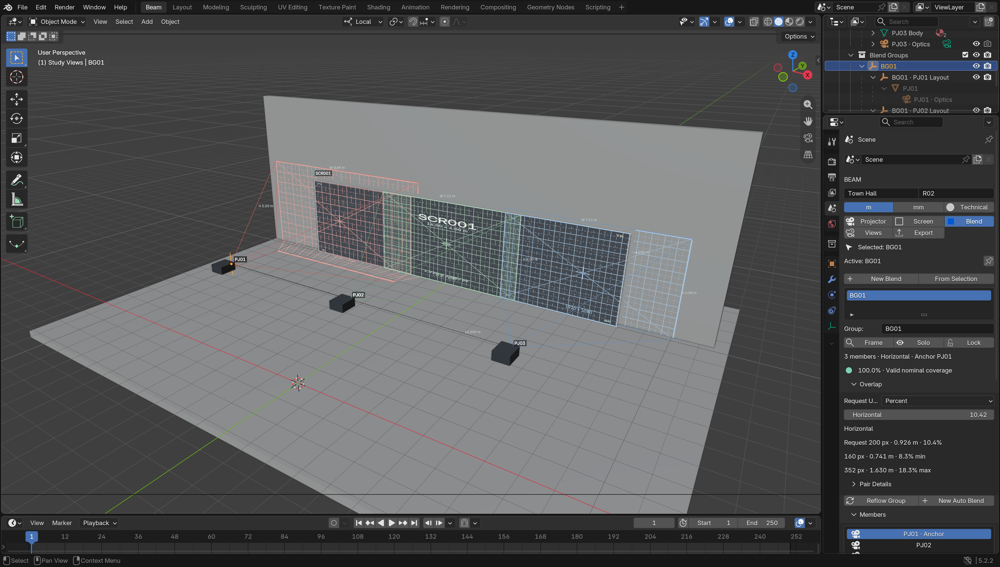
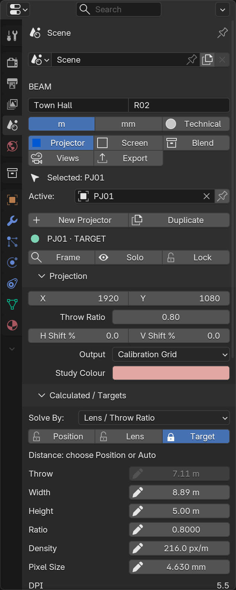
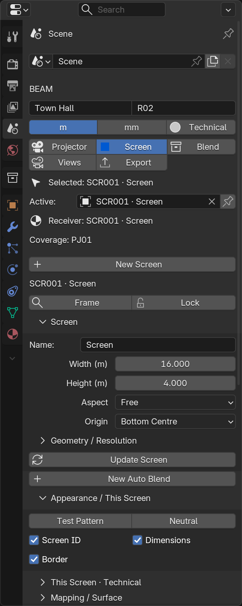
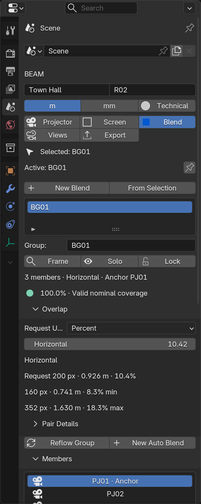
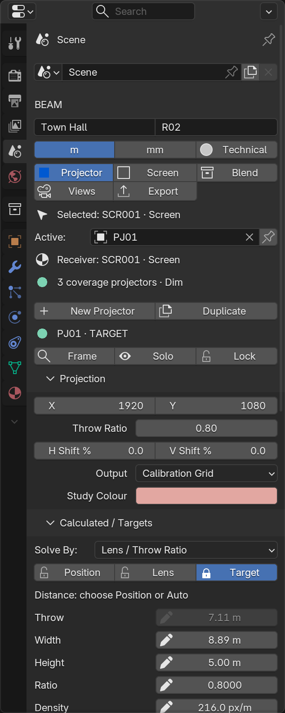

# Beam workspace and navigation — development beta

> Historical milestone / test report. Its screenshots and validation claims describe that milestone. Use [Documentation Baseline](manual/DOCUMENTATION_BASELINE.md) for the current documentation build and current UI evidence.

Maintainer: Twisted Pixel. Original UI foundation: `feature/beam-ui-workspace`, based on reviewed PR #2 merge `846d63a429824f75a127e0c4346dbd76d5f7a6f1`. This UI pass is still in testing; it does not publish a new release.

Current refinement and screenshots: [UI/UX refinement](UI-UX-REFINEMENT.md).

## Open Beam

From a normal Blender **Layout** containing a 3D View, Outliner and Properties editor, open **N → Beam** and click the workspace icon beside **BEAM**, or search **Open Beam Workspace** with F3.

Beam duplicates that layout into an optional **Beam** workspace. The original workspace remains intact. The viewport stays native, the Outliner remains at the upper right, and the Beam inspector appears in the lower-right Properties editor's **Scene** tab. The existing timeline and native editing controls remain available. Resize editor borders normally to suit your screen.

Switch to any other workspace at any time. In Beam, native Properties tabs still expose materials, modifiers and transforms. Click the **Scene** tab to return to the Beam inspector, or use **Open Beam Workspace** again. The regular **N → Beam** sidebar remains available in other layouts.

The compact module rail uses the viewport's native left toolbar. Widen that toolbar to reveal labels; hover icons for module names. If the toolbar is hidden, navigation returns to the inspector. It uses Projector, Screen, Blend, Views and Export. No custom object tree, replacement editor, global theme change or forced workspace switch is installed. If the current layout lacks the required native editors, Beam gives a clear message instead of attempting fragile screen splits.



## Context

- **Selected** is Blender's active selected object, including ordinary venue geometry.
- **Active** is the projector/screen/group/view used by the current Beam module. The pin holds that Beam context while you select other objects.
- **Receiver** is the receiving mesh used by Reverse Mapping. It has a separate pointer and visible source/status; it never silently becomes the active projector.

Viewport and native Outliner selections follow the appropriate inspector. Selecting venue geometry preserves the active Beam objects. Selecting a member through the Blend member list intentionally keeps the Blend inspector open so Remove Selected/Reset Member remain available. Selecting the same PJ in the viewport/Outliner switches to Projector unless pinned.

Automatic Outliner-to-Properties *tab switching* is disabled only inside the Beam workspace; ordinary Outliner object selection remains enabled. This prevents a PJ selection from replacing Beam with Blender's Object tab. Users can still choose every native Properties tab manually.



## Projector and targets

Projection contains resolution, throw ratio, lens shift, output and Study Colour. Calculated shows plain measurements with separate edit buttons. Solver groups Solve By, position/lens/target locks and the active draft. Unsupported edits are disabled; relevant mode/lock/shift restrictions are visible and have tooltips.

Click the pencil beside a calculated value to stage an **inline** target in its Solver section. Edit the number, then click the checkmark to Apply or the X to Cancel. Staging does not move or change a projector. Apply calls the existing transactional solver and supports native Undo/Redo. Changing active projector or scene prevents a stale draft from applying to another object. Drafts clear on load/Undo/Redo and are not durable project engineering data.

Lengths use the displayed m/mm units captured when editing begins; pixel size explicitly uses mm. Density is px/m and ratio is dimensionless. DPI and estimated illuminance remain read-only. The direct optical throw-ratio field keeps its existing behavior; solver locks apply to solved target edits.

Frame, Solo and Lock stay near the identity. Lock protects location/rotation, including quaternion rotation; existing scale locks are preserved. Aim/Position and advanced photometric fields remain available below. Frame reports when the object is hidden/excluded or Blender is in Edit Mode rather than changing the user's editing state.




## Screen and Blend

**Screen → New Screen** reveals creation controls. Existing screen size/aspect parameters stay beside **Update Screen**; pending changes are visibly flagged. Appearance holds the test pattern and screen-specific ID/dimension/border switches. UV mapping, conforming, diagnostics and other editing operations remain available in collapsed sections.

**New Auto Blend** creates another layout/group. **Reflow Group** changes the current group. These are separate actions with distinct labels and icons; no planning algorithm changed.

Blend shows member count, anchor, coverage, overlap requests and compact actual px/physical/% values. Unequal actual overlaps show a min/max range; gaps are flagged. **Pair Details** reveals individual pairs. Members use a short scrollable native list rather than an unbounded column of buttons.





## Views, exports and annotations

Views exposes clickable View/Exit/Previous/Next, name, resolution and Export This View. No numpad is required.

The **Export** module owns CSV, PATCH JSON, current viewport capture, all-Study-View export and screen OBJ/FBX export. The selected Study View's single-image export remains in its contextual inspector.

Annotation scopes are explicit:

- **This Projector · Annotations** affects one PJ.
- **This Screen · Technical / Appearance** affects one screen.
- **This View · Export Annotations** affects one saved view's export.
- **Global · Viewport Display** contains label detail, global helpers/output and preview quality.

Units and Technical/Presentation appear once in the header. Project name/revision appear there; venue/client/author and workspace utilities are in Project/Workspace. Reverse Mapping source/GPU/material warnings appear in the context header even when its detailed controls are collapsed.



## Native collections

New Beam objects are routed into native collections:

```
BEAM
  Projectors
  Screens
  Blend Groups
  Study Views
```

Collection role tags and UUIDs identify containers; changing their names does not break routing. Projector UUIDs, object names, parenting and group recipes keep their engineering meanings.

Existing scenes are not reorganised on load. **Project/Workspace → Organise Beam Collections** is an explicit, undoable action for existing Beam objects. It preserves unrelated venue objects and arbitrary user collection links. Those retained links can make an object appear in more than one Outliner location. Existing venue/import collections are not renamed to SCENE or moved.

## UI architecture and boundaries

- `ui.py`, `screen_ui.py`, `blend_ui.py`: shared native layout functions; the sidebar and optional workspace use one inspector implementation.
- `ui_context.py`: ephemeral inline drafts, restriction display and cached group summaries. Apply delegates to the existing solver.
- `ui_workspace.py`: optional workspace creation, native viewport context bridges, receiver/member UI actions and a 250 ms UI state timer. Redraws occur on state changes; the timer does not continuously invalidate engineering caches.
- `ui_collections.py`: native creation routing and explicit organisation only.
- `ui_icons.py` supplies a small positive-state icon. Active module buttons now use native icons and the optional Beam theme’s blue. Study Colours remain separate.
- `study_data.py`: saved module/pin/receiver/UI selection state alongside existing active-object pointers.

Panel drawing does not run runtime refresh, coverage calculation or pair measurement. The native UI test deliberately forbids those calls while drawing. Group summaries update outside panel drawing and reuse existing coverage state. Collection integration changes only creation/linking boundaries in projector, screen, group and Study View modules.

The projection/inverse/layout/coverage maths, Reverse Mapping/material wrappers, GPU depth maps, CSV and JSON v1 implementation files are unchanged from reviewed main.

## Blender API limits and migration

Blender Python cannot register a full custom editor type or apply a separate theme/font to one workspace. This implementation therefore uses native Properties/sidebar controls, a native toolbar rail with an inspector grid fallback and normal theme-selected buttons. Native button fill/fonts and editor chrome follow the user's Blender theme; the mock’s custom editor chrome and per-workspace dark palette are not reproduced. The workspace does not change the global theme automatically. An optional application-wide preset is now available: see [Theme and workspace](THEME-WORKSPACE.md).

The optional workspace retains native Scene context headers and other Scene panels below Beam. Materials/modifiers remain one native tab away. Returning to Beam uses Scene or Open Beam Workspace. A user workspace already named Beam is not overwritten; Blender may suffix the new workspace name.

No engineering-data migration or export-schema migration is required. New UI properties have defaults. Existing files retain their original collection memberships unless explicitly organised. Restart Blender after replacing an installed extension to avoid keeping old Python panel classes loaded.

Validated on Blender 5.2.2 LTS / macOS Metal. Blender 4.5 and Windows/Linux remain unverified. The original engineering beta limits still apply: zero lens shift for Position solves, nominal planar Auto Blend coverage, and GPU-viewport-only live Reverse Mapping.

## Verification and follow-up

See [TEST_RESULTS](../TEST_RESULTS.txt) for exact runs. The new native UI test covers all module captures, actual Outliner navigation, pinning and ordinary geometry selection, inline target Undo/Redo, save/reopen, Properties-launched Frame/Lock/Presentation/export, screen update, Auto Blend Undo/Redo and member operations. It also asserts that native Outliner selection does not switch away from the Beam inspector.

Recommended follow-up: test narrower/laptop layouts and other Blender versions; refine default editor proportions for different displays; collect real venue feedback on target-edit discoverability and long-group summaries. Keep native editor access and engineering behavior intact during further polish.
