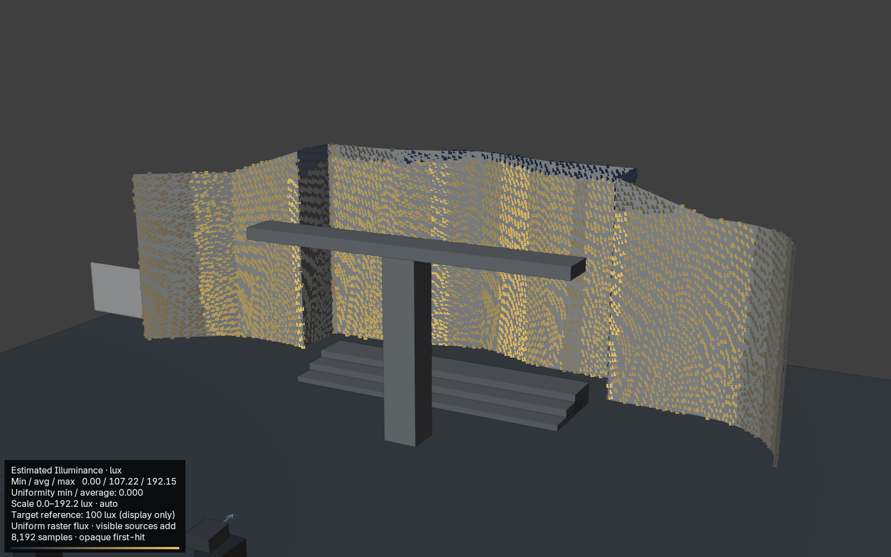
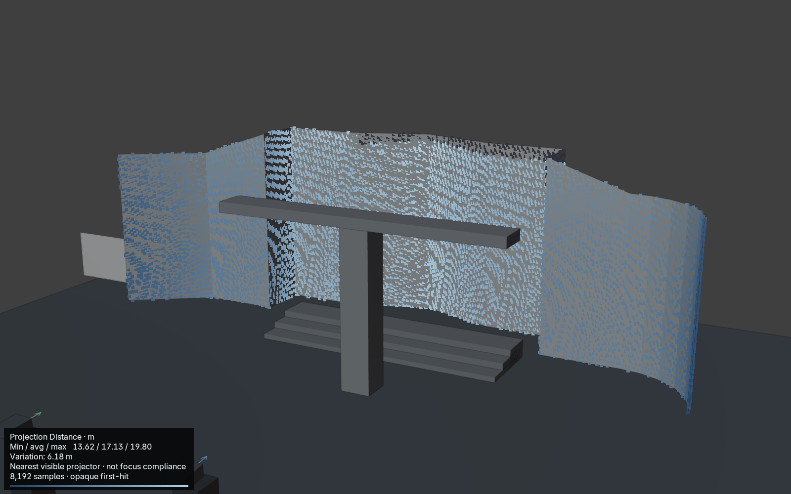
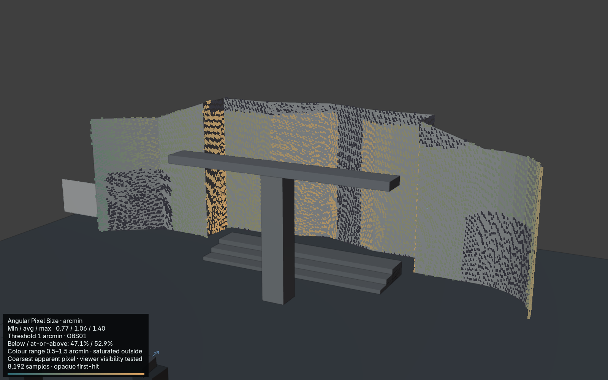

# Beam 0.13 — Surface Intelligence manual delta

Maintainer: **Twisted Pixel**. **Controlled Internal Production Beta** for the validated Blender 5.2.2 LTS / macOS 26.7 / Apple silicon Metal environment. Still in testing. No public/stable release or tag. This supplements the frozen 0.12 manual; it does not replace its source, screenshots or baseline.

## Find and run Surface Analysis

In the Beam inspector, expand **Surface Analysis**. Use the compact **Heatmap** dropdown: Density, Stretch, Illuminance, Distance or Acuity. Choose a **Receiver**, the **Projectors** source scope and **Samples**, then click **Analyse Surface**. Start with Standard (2048), and use Detailed (8192) to examine smaller features. Changing only the displayed mode reuses the calculation.

The heatmap displays sampled points, not a continuous certified surface map. Unsampled gaps and thin obstructions can be missed. Grey samples have no applicable value; zero incident lux is the darkest illuminance colour. Statistics describe the chosen receiver, not the whole venue.

## Estimated Illuminance

Lux measures incident luminous flux per unit surface area: one lumen per square metre. Select **Illuminance**, then **Analyse Surface**. Beam estimates how nominal projector output distributes over the actual receiver geometry, including orientation, distance and first-hit obstruction.

Visible projector contributions **add** in overlaps. An opaque blocker removes that source's contribution. Beam reports minimum, average and maximum lux over the sampled receiver, including unlit samples as zero. **Uniformity min / average** is a ratio: 1 means equal sampled values, 0 means at least one unlit sample when the average is positive. The exported minimum / maximum ratio is separately named. Entirely dark receivers have undefined uniformity.

**Auto Scale** uses the current minimum and maximum. **Fixed Range** uses zero to **Maximum Lux**, useful for revision comparisons. **Target Illuminance** adds a labelled reference value; it neither changes the output nor creates a pass/fail certification. The field example uses a 100 lux reference and a 0–250 lux fixed range.

[Fixed-range comparison](../../examples/surface-intelligence/field/illuminance-fixed.png).

Estimated incident illuminance is not photometrically calibrated. Beam assumes uniform flux per raster pixel and nominal lumens × stack quantity × brightness percentage. It does not model measured output distribution, lens transmission, ageing, calibration or colour-mode losses, edge falloff, screen gain, reflectance, ambient light, black level or colourimetry. This is not measured screen luminance.

## Projection Distance

Select **Distance** and analyse. The value is the Euclidean distance from a visible projector's lens origin to each receiver sample. In overlaps, the nearest visible projector controls; its UUID is retained in the export. Unlit samples are excluded from the statistics.

Read minimum / average / maximum and **Variation**, which equals maximum minus minimum. Display follows Beam's m/mm preference; structured distances are metres. Even a flat perpendicular wall has radial distance variation toward its edges. The field scene spans 13.62–19.80 m, a 6.18 m variation.

Use this to identify depth changes for planning. It does not certify optical focus or depth of field; that requires lens-specific evidence.

## Observer and Acuity

1. Choose **Acuity** in Surface Analysis and click **Add Observer**. The new object is named **OBS01** (or the next free number) and is placed at the 3D Cursor.
2. Find it in Blender's Outliner or viewport. Select it and use Blender's move tool, or the inspector's **Base Position**, to place it at the audience location.
3. Set **Eye Height (m)**. This is an offset in world-up from the object's base; the default is 1.6 m.
4. Select that object in the **Observer** field. Set **Acuity Threshold (arcmin)**; the default **1 arcminute** is adjustable guidance.
5. Choose receiver and sources, then **Analyse Surface**.

**Angular Pixel Size** reports the apparent projected pixel pitch at the observer's eye, including surface foreshortening. Larger values mean a coarser apparent pixel structure. The overlap rule uses the coarsest visible source structure, rather than Density's highest-detail source. Viewer-blocked and unlit samples are excluded. Below / at-or-above percentages refer to the observable lit area, not the whole receiver.

The colour scale runs from half to one-and-a-half times the threshold and saturates outside that range. In the field example, 47.1% of evaluated area is below 1 arcminute and 52.9% is at or above it. Moving closer increases apparent pixel size; moving farther away reduces it.

This is a viewing-resolution diagnostic. It does not predict eyesight, contrast perception, content readability or ambient-light effects. Multiple Observer objects can be stored, but one active Observer is analysed at a time.

## Study Views, saving and stale results

In **Views**, set **Analysis Overlay** to the required mode and export. PNGs include the relevant legend and statistics; companion `.analysis.json` files retain assumptions, identifiers and image hashes. **Export → Study Package** collects the views and additive analysis metadata. Existing CSV formats remain unchanged. PATCH's receiving GUI has not been validated with the new fields.

Relevant source, geometry or Observer changes require **Analyse Surface** again. Stale selected overlays are not exported. A Study Package containing partially stale metrics requires a fresh analysis. Display-only lux range and target changes do not alter the calculation.

Saving retains projectors, optics, Screens, Blend Groups, Observer settings and Study Views. Analysis caches are deliberately not saved. After reopening, choose the receiver and run **Analyse Surface** before exporting analysis views. Undo/Redo clears transient analysis; regenerate it.

## Training example and manual handoff

Open [Beam-Civic-Hall-Field.blend](../../examples/surface-intelligence/field/Beam-Civic-Hall-Field.blend). It contains four Christie-preset projectors, a recessed/curved facade, a blocking portico, a Beam Screen, Blend Group and OBS01. Six saved views cover Overview and all five analysis modes. [Field evidence and results](../surface-intelligence/PR8-REVIEW.md).

When the 0.12 documentation project finishes, update only these sections in its next revision:

- **Surface Analysis:** three new modes, units, source rules, defined uniformity and Observer visibility.
- **Study View overlays:** new choices, legends, sidecars and stale-result requirements.
- **Where Is It?:** Surface Analysis dropdown and Add Observer.
- **Training Project exercises:** compare the five civic-hall views, move the blocker and Observer, compare auto/fixed lux, save/reopen and regenerate.
- **Troubleshooting:** missing Observer, no lit/observable samples, stale analysis after edits or Undo/Redo, and analysis absent after reopening.
- **Known limitations:** sampled estimates, photometric exclusions, no focus certification, adjustable acuity guidance and unverified receiving applications.

Do not regenerate the complete 0.12 guide or replace its screenshots as part of this handoff.
